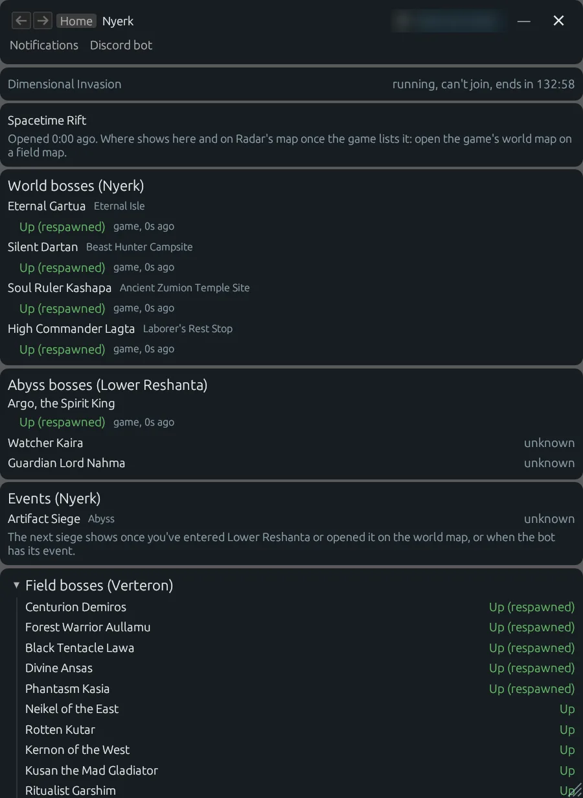
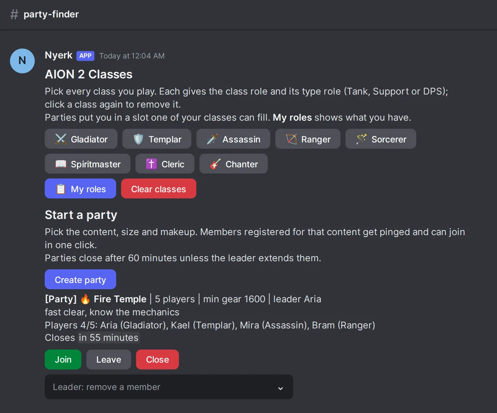

## Every MMO community has the same three questions

When does the boss spawn? When are we raiding? Who wants to run a dungeon right now? Those three questions eat a startling amount of any gaming Discord's chat, and they get asked again every single day, usually by someone who scrolled past the answer an hour ago.

This last part of the series is about the pieces that answer them: boss timers, raid scheduling, and the party finder. Unlike the coin games in [Part 7](/blog/2026/ai-agent-platform-part-7) or the member tools in [Part 8](/blog/2026/ai-agent-platform-part-8) and [Part 9](/blog/2026/ai-agent-platform-part-9), this stuff is all about time, and time turns out to be the sneakiest problem in the whole platform. More on that in a bit.

## Nyerk, the bot that moved in

Some history first, because it explains the names in the screenshots. Boss timers, the party finder, and the game news feed started life in a separate Discord bot called **Nyerk**, with its own repo. That repo merged 86 pull requests during the same month covered in [Part 1](/blog/2026/ai-agent-platform-part-1), which is how the platform's total comes to 1,031 merged PRs instead of 945.

Nyerk has since been folded into pyaaa. Its code now lives inside pyaaa as its own module, the `/nyerk` command group sits in pyaaa's command registry, and the party finder buttons still follow the archived Nyerk layout. The messages still post under the Nyerk name, and the web pages are still "the Nyerk site," but it's one bot underneath. Same playbook as the Cube Radar to Nyerkulator move from Part 1: change the plumbing, keep what people see.

## Boss timers, straight from the game

The best boss timer is one nobody has to type in. The desktop app's Nyerk tab reads world, Abyss, and field boss timers from the game itself, plus the state of the Dimensional Invasion, and the Home page card for it has an "Upload to Nyerk" switch that shares those timers with the bot. As with everything else in the app (see [Part 4](/blog/2026/ai-agent-platform-part-4)), this is all read passively from what the game already sends.

Getting those timers from the app to the bot is where one of the more instructive bugs lived. The app forwards timers through the Nyerkulator server to the bot's API, and those requests started timing out: the bot's API was hanging for about 15 seconds, past the server's 10 second timeout, because it was writing a log line inside the same database transaction that saved the timers. Moving the log write to after the save fixed it. I told that one in more detail in [Part 7](/blog/2026/ai-agent-platform-part-7), so I'll just leave the lesson here: anything that isn't the actual data change has no business inside a transaction.

## The dashboard in Discord

On the Discord side, all of this lands in one channel. Nyerk posts spawn alerts that ping opt-in roles (World Boss, Rift, and so on) a few minutes ahead, and keeps one live dashboard message pinned at the bottom: server resets and maintenance, upcoming events, and the world boss route with when each boss respawns.

Under the dashboard are one-tap buttons, one per world boss, labelled "Eternal Gartua died" and so on, plus a "Custom time" button. Somebody kills a boss, they tap the button, and everybody's timer updates. If they killed it a while ago, `/nyerk worldboss` takes a relative time ("10 min ago"), and `/nyerk mytimers` lists the timers you've reported, with a cap on how many one person can have running at once. Game news gets the same treatment: Nyerk reposts the official Announcements and Updates boards into a news channel, pulls maintenance windows out of the notices, and adds a short auto summary. The news settings page is explicit that the summary is made on the server from the post's own text and nothing is sent to any AI service, which felt worth saying out loud on a project this full of AI.

{{< carousel images="{timer-commands.webp,news-feed.webp}" captions="{timer-commands.webp:Reporting a kill with a relative time and listing your own timers,news-feed.webp:Official notices reposted with the maintenance window and an auto summary}" aspectRatio="16-9" interval="6000" >}}

## Time zones, the actual hard part

Here's the thing that makes this whole area sneaky. The community doesn't live in one time zone, the game doesn't use one time zone either, and daylight saving time changes on a different schedule than any of it.

The rules the Nyerk pages settled on:

- **Every time a member sees is in their own time zone.** Discord's timestamp format renders each reader's local time, so every alert, dashboard line, raid post, and poll uses it. The web pages do the same thing in the browser, and say so right under the dashboard preview.
- **The game's fixed events stay fixed.** The new-event form notes that Aion 2's resets and maintenance run on UTC, while things like the Spacetime Rift, Artifact Siege, and a few Abyss bosses run on the regional America/New_York clock. One of those is even marked as inferred and still to confirm in game, which is the kind of honesty I like seeing in a config screen.
- **Maintenance is pinned to UTC.** The regular weekly window doesn't move when clocks change, members see it in their own time, and an override replaces the window for one week only. Emergency windows get added separately.

That event form is also where most of the flexibility lives. An event can be weekly on certain days, at a list of times, every N hours from an anchor time, on a day of the month, or a one-off date, each with its own time zone. Boss events use a respawn length, so the kill time plus the respawn is the alert time. Every event has three alert slots (15 minutes before, 5 minutes before, and at the time), new events start disabled until saved as enabled, and alert slots start switched off until someone turns them on. Nothing pings half the server by accident just because somebody saved a half-finished form.

The overview page ties it together: whether the bot is online, how many boss timers are active, a preview of exactly what the dashboard shows right now, and a recent activity log. One of the demo log lines is "Alert channel is missing a role ping; posted without ping," which is the right failure mode. The alert still goes out, it just doesn't ping, and the problem lands in the log where an admin will see it.

{{< carousel images="{site-overview.webp,site-events.webp,site-event-new.webp,site-maintenance.webp,site-news-settings.webp,site-logs.webp}" captions="{site-overview.webp:Overview with the live dashboard preview and recent activity,site-events.webp:Every event with its schedule and alert slots,site-event-new.webp:The new event form with schedule types and time zones,site-maintenance.webp:The weekly maintenance window pinned to UTC,site-news-settings.webp:Game news feed settings,site-logs.webp:The bot log}" aspectRatio="16-9" interval="6000" >}}

## Raids

Raids live in a forum channel, one post per raid. The post shows when it is (in each reader's own time, and whether it repeats every week), the leader, who can join, a short note, and the roster grouped by role: tanks, DPS, clerics, and chanters, each with a count against the slots. Join, Leave, and Manage buttons sit under it.

The raid's thread does the nagging so the leader doesn't have to. The leader gets told their raid is up and that Manage is how to invite people or change anything. The roster gets a reminder with Coming and Can't make it buttons. When someone asks to join a raid that needs approval, the leader gets a request with "Accept as DPS," Details, and Decline, and the request expires on its own. A pinned raid list shows every live raid exactly once, split into upcoming, recruiting, and full.

Then there's the part I'd point anyone to if they're building something similar: **Find a time**. Instead of a raid leader posting "when is everyone free?" and reading forty replies in nine time zones, they start a vote. Every slot shows in your own time zone. You pick every time you can make, or tap "Use my usual times" to fill it in from your saved weekly availability. The poll shows **counts only, and names stay private**: the poll's organizers and staff see who answered what, but everyone else just sees how many can play, so nobody gets called out in public for being the one person who can't make Tuesday. It highlights the best slot so far along with role coverage for it, and the leader can schedule the best slot in one click.

{{< carousel images="{raid-post.webp,raid-notices.webp,raid-list.webp,find-a-time.webp}" captions="{raid-post.webp:A raid post with the time in each reader's zone and the roster by role,raid-notices.webp:Thread notices for the leader and the roster and a join request,raid-list.webp:The pinned raid list showing every live raid once,find-a-time.webp:Find a time with counts only and the best slot with role coverage}" aspectRatio="4-3" interval="6000" >}}

"My usual times" is a small page where you set the hours you're usually free on each weekday, used to fill in those votes for you, and changeable in Discord with `/availability`. The privacy page is careful about what that means: a raid's leader and staff can see privately whether your usual times fit the raid's time, but the raid post only shows how many signed-up members are usually free, and only once at least three people have saved usual times. Small groups are where "anonymous" counts stop being anonymous, so the count doesn't show until there's a crowd to hide in.

## The party finder

Raids are planned. Dungeon runs mostly aren't, and that's what the party finder is for. Its Discord channel has two panels. The first is a class selector: pick every class you play, and each gives you the class role plus its type role (Tank, Support, or DPS), so parties can put you in a slot one of your classes can fill. The second is "Start a party": pick the content, size, and makeup, and members registered for that content get pinged and can join in one click. Parties close after 60 minutes unless the leader extends them, and the leader can remove a member from a dropdown.

Behind the panels there's more control than the two buttons suggest. Members set a gear score bracket, shown on party listings, and dungeon pings only reach members whose gear score meets that dungeon's minimum. Members can set quiet hours that pause their dungeon pings every day in their own time zone, while event pings still come through. Messages typed in the party channel get deleted after a set time so the channel stays a list of parties and not a chat log, and there's a per-member limit of at most one interest ping every 15 minutes by default.

Everything a member can set from Discord buttons, they can also set from their own page on the Nyerk site: boss timers (cancel or change time), classes and pings, gear score, quiet hours, raids attended, and the party they're in. The page says it plainly: changes here are the same as using the buttons in Discord.

## The staff side

Staff get the rest of the Nyerk site. The party finder page manages the panels, member chat cleanup, the class and type roles and standard makeup, the content list with dungeon ping roles and minimum gear, the gear score brackets and availability windows, and the open parties. The roles page edits the roles channel: the header, event ping categories, role messages, and a preview of exactly what will post. The members directory shows everyone Nyerk has seen with their classes, gear, and activity, and opening a member lets staff change their roles, quiet hours, and timers.

That member page also has a **Forget this member** button, for privacy requests. It deletes their records, gear score, quiet hours, registrations, and past party seats, takes them out of any party, and removes their name from boss timers, parties they led, and the logs, and can also strip the class and ping roles Nyerk manages from them in Discord. Nightly backups still hold the old data until they age out, and if one gets restored in that time, Nyerk forgets them again on its own by keeping just their Discord ID and the date on a short "forgotten" list. Thinking about the backup case is the part most "delete my data" buttons skip.

Stats show party activity (parties started, fill rate, average time to fill), a heatmap of when parties start, content demand, class distribution, and the most active members. The settings page holds channels, dashboard text, and party timing, with one JSON export and a preview-before-apply import. And access and security is where the levels live: the server's owner, admins (Manage Server or a chosen admin role), and members, with a table of exactly what each level can and can't do. Admins are limited to 30 changes an hour, some areas stay owner-only unless opened up, nobody can raise their own level from the page, and there are two emergency switches: lock admin access if an admin account looks compromised, and sign everyone out.

{{< carousel images="{site-party-finder.webp,site-roles.webp,site-members.webp,site-member-detail.webp,site-stats.webp,site-settings.webp,site-access.webp}" captions="{site-party-finder.webp:Party finder admin with panels and member chat cleanup,site-roles.webp:The roles channel editor with ping categories,site-members.webp:The member directory with Discord IDs blurred,site-member-detail.webp:A member's activity and the Forget this member button,site-stats.webp:Party activity and the when parties start heatmap,site-settings.webp:Server and game settings with export and import,site-access.webp:Access levels and the emergency switches}" aspectRatio="16-9" interval="6000" >}}

The access rules will look familiar if you read [Part 3](/blog/2026/ai-agent-platform-part-3). It's the same idea I used for the AI agents, applied to human admins: decide up front who can change what, rate-limit the people who can, and keep a big red button for when something looks wrong.

## Members' pages, on a phone

The member-facing pages also work at phone width: My page, My usual times, the boss timers page, the party finder, the overview, and the sign-in page.

{{< carousel images="{m-my-page.webp,m-my-availability.webp,m-boss-timers.webp,m-party-finder.webp,m-overview.webp,m-login.webp}" captions="{m-my-page.webp:My page on a phone,m-my-availability.webp:My usual times on a phone,m-boss-timers.webp:Boss timers on a phone,m-party-finder.webp:Party finder admin on a phone,m-overview.webp:The overview on a phone,m-login.webp:Sign in with Discord}" aspectRatio="9-16" interval="6000" >}}

Signing in is Discord only, and the sign-in page says up front that Nyerk only sees your Discord name and ID and then checks your roles in the server. Help pages cover using Nyerk from a member's side, how it behaves (restarts, kill reports, cleanup, time zones, pings), and the access levels. The privacy policy lists exactly what Nyerk keeps, what it doesn't (the text of your messages, your email or password, your IP address except briefly for rate limits), who can see it, how long it's kept, and how to have it all forgotten. The terms say what Nyerk is for, that timers can be wrong so check in game, and that it's a fan-made tool not affiliated with NCSOFT or Discord.

{{< carousel images="{site-login.webp,site-my-page.webp,site-my-availability.webp,site-help.webp,site-privacy.webp,site-terms.webp}" captions="{site-login.webp:Sign in with Discord only,site-my-page.webp:A member's own page,site-my-availability.webp:My usual times on desktop,site-help.webp:Help pages,site-privacy.webp:The privacy policy,site-terms.webp:Terms of use}" aspectRatio="16-9" interval="6000" >}}

## Wrapping up the series

That's the whole thing. Over ten parts:

- [Part 1](/blog/2026/ai-agent-platform-part-1) covered what the platform is and how a one-feature cube radar turned into it.
- [Part 2](/blog/2026/ai-agent-platform-part-2) and [Part 3](/blog/2026/ai-agent-platform-part-3) were the operations side: running 29 agents through one merge queue, and giving them production access without a shell.
- [Part 4](/blog/2026/ai-agent-platform-part-4), [Part 5](/blog/2026/ai-agent-platform-part-5), and [Part 6](/blog/2026/ai-agent-platform-part-6) were the app: passive game reading, minimap tracking from user reports, and making things faster without changing a single output.
- [Part 7](/blog/2026/ai-agent-platform-part-7) through this one were the community side: the coin economy, the member experience, server management, and now timers, raids, and parties.

If there's one thread running through all ten, it's that the agents were never the hard part to get typing. The hard part was everything a sysadmin already worries about: who's allowed to change what, how you prove a change didn't break anything, what happens when a backup gets restored, and what the person on the other end of the screen actually sees. Time zones just happened to be the place this part learned it.

The repos are private and still in active development, so this probably isn't the last you'll hear about it. But for now, the boss timers are running, the raids are scheduled, and nobody has to ask "what time is that in my time zone?" anymore. Probably.
