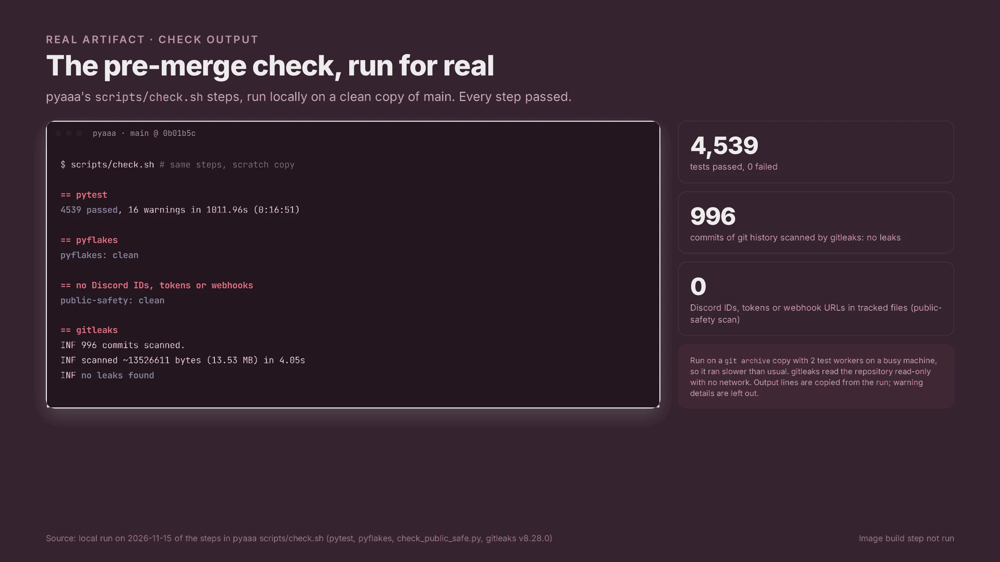

[Part 1](/blog/2026/ai-agent-platform-part-1) covered what the platform is and the headline number: 945 merged pull requests across two repos in 29 days. This part is about how that number happens without the whole thing turning into a pile of half-merged branches, and honestly, it's the part of this project that felt most like my actual job. Writing code was never the bottleneck. Keeping 29 very fast, very literal coworkers from stepping on each other was.

## What 945 pull requests looks like

Before the how, here's the what, because the shape of the numbers says a lot about the process behind them:

{{< carousel images="{merged-prs-daily.webp,cumulative-merged.webp,areas-changed.webp}" captions="{merged-prs-daily.webp:Merged pull requests per day across both repos with a peak of 118 on November 9,cumulative-merged.webp:Cumulative merged pull requests per repo with both past 460,areas-changed.webp:Where the merged pull requests landed by folder in each repo}" aspectRatio="16-9" interval="7000" >}}

The app and server repo started first and climbed steadily from October 19th. pyaaa didn't really get going until about a week later, then reached 463 merged pull requests in roughly three weeks, which is how both repos ended up past 460 at almost the same time.

The third chart is where the work actually landed, and it's my favorite of the three. 95% of pyaaa's pull requests changed tests. A third of the app repo's pull requests changed ops, deploy, or host gate code, which is a lot of infrastructure work for what started as a cube radar. And docs got touched by 46% of the app repo's pull requests and 60% of pyaaa's. A lot of the numbers in this series exist only because the agents were made to write down what they did and how they verified it, every time. The rest of this post is the machinery that makes that happen.

## An agent is a Markdown file

Every one of the 29 agents is a Markdown file. The top of the file is a little block of frontmatter: a name, a description, which model it runs on, and how much effort it's allowed to spend thinking. The body is its job.

The description field is more important than it looks. When I ask for something, the agent that gets the work is picked by its description, so a description like "the only agent that merges PRs into main" isn't flavor text. It's the mechanism that keeps every other agent from merging. Write a sloppy description and you get the wrong agent doing the work, the same way a sloppy ticket gets routed to the wrong team.

The other thing I learned fast is that the body should read like a procedure, not a personality. "You are a careful, senior engineer who values quality" does basically nothing. Numbered steps, exact commands, and "stop unless the exit code is 0" do a lot. The merge-queue agent's definition reads more like a runbook than a character description:

```
## Per PR
1. git fetch, then check out the PR branch
   in your own worktree (never the main
   checkout).
2. Bring it up to date by merging
   origin/main into the branch.
   Never force-push.
3. Assign versions at merge time: the next
   free number after main's latest.
4. Run ./scripts/check.sh in the
   background ...
5. On rc=0, check the branch head and
   origin/main haven't moved, then:
   gh pr merge <n> --merge \
     --match-head-commit <sha>
```

And right next to what each agent does sits what it must never do. The merge queue never releases the app, never posts announcements, and never touches Discord. Nothing edits the host gate's files except a reviewed PR that bumps its version number. When an agent learns something the hard way, the lesson gets appended to its definition with a date, so the next run doesn't have to learn it again. If you've ever kept a runbook with a "known issues" section at the bottom, it's that, except the runbook is also the employee.

Each app feature gets its own agent (Radar, Market, Tiles, Duty, Pets, Combat, and so on). Others own the server and website, the Discord bot's dashboard and games, security, and deploys. One more runs the merge queue. On top of the definitions there's a shared memory, a folder of short notes every agent can read, covering things like the review policy, the model tiers, and how many builds can run at once. That's where the rules live that apply to everyone.

## The rules

Twelve of them, as of this writing, written into the agent definitions and shared memory, and backed up by the permission system and the hosts themselves where words alone weren't enough:


A few of these deserve more than a box on a slide.

**The owner decides.** App releases, database migrations, credential rotation, and anything posted publicly need my OK. Agents also can't edit their own settings or their own definitions, which sounds obvious until you realize that "I'll just loosen my own permissions to finish this task" is exactly the kind of thing a very helpful agent with no judgment about scope would happily do.

**Secrets are never printed and never committed.** They live in a git-excluded `private/` folder and get read at the moment they're used. The check scripts scan for tokens, Discord IDs, and webhook URLs, and in pyaaa, gitleaks scans the whole history on every check.

**Start cheap, escalate.** Every agent starts on the cheapest model at low effort. Agents that touch production start one tier up. The top tier, at medium effort, is the ceiling. Most work doesn't need the biggest model, and a lot of the work that seems to need it actually needs a better task description.

**Capped parallelism.** About four feature agents write code at the same time, each in its own isolated git worktree. Builds share a fixed number of slots, so my PC doesn't run out of memory when four Rust builds kick off at once.

## The pipeline, start to finish

Here's what every change goes through, from an agent's branch to a pinned production deploy:


The first half is the part this post is about:

1. A feature agent works in its own worktree and build directory, runs focused tests for what it changed, and opens a PR that says what it did and how it was tested.
2. A separate agent reviews the final diff. Anything touching the host gate or ops code gets a security review. The only exemption is a one-line text or style change.
3. The PR goes to the merge queue.
4. The merge queue runs the full check and needs exit code 0.
5. It merges with `--match-head-commit`, which refuses if the branch moved after the check.

The second half (clean builds, GHCR, digest-pinned deploys, and the standby host) is [Part 3](/blog/2026/ai-agent-platform-part-3).

### Review is a rule, and it earns its keep

Independent review is a written rule: a separate agent reviews the final diff before anything merges. I'm not going to pretend I have a coverage percentage for it, because I don't. What I do have is the review catching real problems, the kind I would much rather find in a PR comment than in production.

A good example is a pyaaa fix for channel locking. pyaaa can lock a channel and revert any change someone makes to its permissions. When a role was deleted by another bot, Carl-bot in this case, pyaaa got stuck reverting the same locked channel over and over. The first fix added a loop guard. The reviewer found that the guard decided a channel was "stuck" based on gateway events that came in afterward, which meant a member who just kept repeating the same change could convince pyaaa to stop enforcing the lock entirely. Rated HIGH. A lock that a determined member can switch off by being annoying isn't a lock.

The fix: "stuck" now comes only from Discord's answer to pyaaa's *own* edit, and only gets set after that edit succeeds. Overwrites for deleted roles get pruned, and a per-channel lock covers both enforcing and pruning so they can't race each other. The second round of review came back with no blocking findings, and all six issues from the first round were fixed.

Here's what that loop looks like on a host gate change that was reviewed, sent back, fixed, re-reviewed, and merged in under twenty minutes from the first review:


The reviewer didn't just read the diff and say it looked fine. It reproduced the leak with the shipped awk, then on re-review threw a pile of odd inputs at the fix (bare names, bracketed names, tabs, unicode, long tokens) to confirm they all got folded away. That's the behavior I want: show me, don't tell me.

## The merge queue, and why only one agent merges

Here's the problem that created it. A full `check.sh` takes 15 to 20 minutes. Early on, each agent finished its PR, rebased onto main, ran the check and merged. Which worked great with one agent. With several, every merge moved main, which meant every other agent's freshly checked branch was now behind, which meant rebase and run the 20-minute check again, which meant by the time it finished someone else had merged, and so on. A team of agents politely shoving each other to the back of the line forever.

The fix was boring, which is how I like my fixes:

- **One merger.** A single merge-queue agent is the only thing allowed to merge. Authors finish their PR and hand it over. They never merge it themselves.
- **One at a time, or small batches.** It takes PRs oldest first, or batches of 3 to 5 small, independent ones together on one integration branch.
- **Versions at merge time.** Version numbers get assigned by the merge queue when the PR merges, not by the author when they open it, so two PRs can't both claim the same version and nothing ever has to be renumbered.
- **No rewriting history.** Branches catch up by merging main in. Force-push is blocked.
- **Remove the conflict hot spots.** Every PR writes its own CHANGELOG fragment instead of everyone editing the same file, and some files that used to be edited by hand are now generated during the build. Those two remove the usual conflict hot spots.
- **Every PR gets the full check.** Docs-only included. The rule is exit code 0 on the PR's exact head commit, not "the tests passed on something close to this."

And this is what that check actually looks like when it runs, in pyaaa's case:



On the app side, the same idea with different tools: rustfmt, clippy with warnings treated as errors, the workspace tests, a Windows build, the host gate's tests, and the ops runner's rules.

### Why the check is local and not in GitHub Actions

Short version from Part 1: we ran out of minutes. At this volume, GitHub Actions minutes ran dry, so CI moved to a local `check.sh` plus a script that builds and pushes the image. In hindsight that was fine. The check runs on hardware I control, the merge queue is the only thing that runs full checks, and it runs them strictly one at a time, so there's no fleet of runners to babysit.

## The lessons, mostly learned the hard way

These are all recorded in the project's notes, which is the only reason I can tell you about them in this much detail. Writing things down remains undefeated.

**A stale result file nearly passed a PR.** A leftover result from an earlier run came close to counting as a pass for a PR it had nothing to do with. It got caught before anything landed, and it's exactly why the rule says exit code 0 on the *exact head commit* and why the merge uses `--match-head-commit`. "A check passed" and "the check for this commit passed" are not the same sentence.

**Shared build targets lie.** Worktrees that shared one Rust build target directory started throwing "cannot find" errors that weren't real. One agent's build was stepping on another's output. Now every check runs in one fixed worktree, with a separate target directory per build slot.

**Stacked PRs and stale bases.** When one PR is built on top of another and the bottom one merges, the top one can end up merging into a base that no longer exists the way it expected. That happened twice (pyaaa #262 and #377), and both had to be re-landed as fresh PRs (#267 and #378). The PR #442 example above is stacked too, and its description says exactly that: "merge #441 first or together."

## Agents asking for things that could never work

This one is my favorite, because the answer wasn't "the agents are bad" or "the rules are too strict." It was a visibility problem.

Some host operations, like a deploy or installing a new gate version, go into a queue for me to approve with a passkey (more on that in [Part 3](/blog/2026/ai-agent-platform-part-3)). Agents queue the request, and I approve or decline. The problem was the agents couldn't see the state of the host they were asking to change, so some of what reached me could never have run.

So I had a post-mortem done on every request that got refused or failed. It counted **13**. The part that actually mattered: **none** of them was a safety refusal stopping a bad change. Most fell into two buckets. Four were preconditions the agent could have checked for itself before asking, and eight were bugs that only showed up under real host conditions, like a root umask of 077 or a sandboxed user. In other words, the safety system wasn't saving me from anything here. It was just catching avoidable noise and making me look at it.

The fixes went in as a handful of PRs:

- A **preflight script** that answers "not now" with the earliest time it would work, instead of letting the agent queue a request doomed to fail.
- Agents can **read the host's refusal reason**, so they can fix the actual problem instead of guessing.
- Requests that never got a summary written get **filed away from my list**, so my approval queue is only things I can actually approve.
- A **test harness that reproduces the host's sandbox**: umask 077, an unprivileged user, read-only, no network. Those eight "only on the real host" bugs are now reproducible on my PC.
- **Diff size limits are checked before queuing**, not after.
- Linked standby pins **no longer count against the daily cap**.

That's the most sysadmin lesson in this whole post: when something fails a lot, the answer is rarely to stare harder at the failures one at a time. Count them, sort them, and fix whatever is producing them.

## Betas that could never reach stable

One more, because it shows how a tiny rule in the release process can quietly break people.

The app has a beta channel. Betas used to be named after the stable release they were built on and sorted *after* it, so 1.2.16 came before 1.2.16b. Reasonable on paper. In practice, betas came out *before* their stable release. So a tester on 1.2.16b was, as far as the version check was concerned, already ahead of 1.2.16, and would never be offered the stable release. My beta testers were stuck on the beta forever, which is a strange way to thank people for testing.

The fix turned betas into proper pre-releases: 1.2.17b comes before 1.2.17b2, which comes before 1.2.17, with the version check changed on both the app and the server. Version 1.2.16 will never ship as stable, and the build scripts refuse to build it, so the ambiguous number simply can't exist. For older apps that can't parse "b2," the server keeps a "bridge" copy of the previous signed beta manifest with its bytes unchanged, so it still verifies and no signing key had to touch the server to make it work. Beta testers now always reach the full release of their beta's number, and stable users never see betas.

This is also part of why the merge queue assigns versions at merge time. When versions are handed out in one place, by one agent, in merge order, the numbering stays boring. Boring numbering is what you want.

## Wrapping up

None of this is new. A single path to main, required reviews, merge on green, no force-push, small batches, write your lessons down, post-mortems that count things. It's how any decent team ships. The difference is that a human team picks up most of these habits from experience and the occasional bad week. Agents don't pick up anything you didn't write down, so a lot of the rules in this post exist because something went sideways without them.

Next up: [Part 3](/blog/2026/ai-agent-platform-part-3), where agents get production access, just not the kind with a shell.

Both repos are private and still in active development, so there are no links here. PR numbers and figures come from the project's own records.
