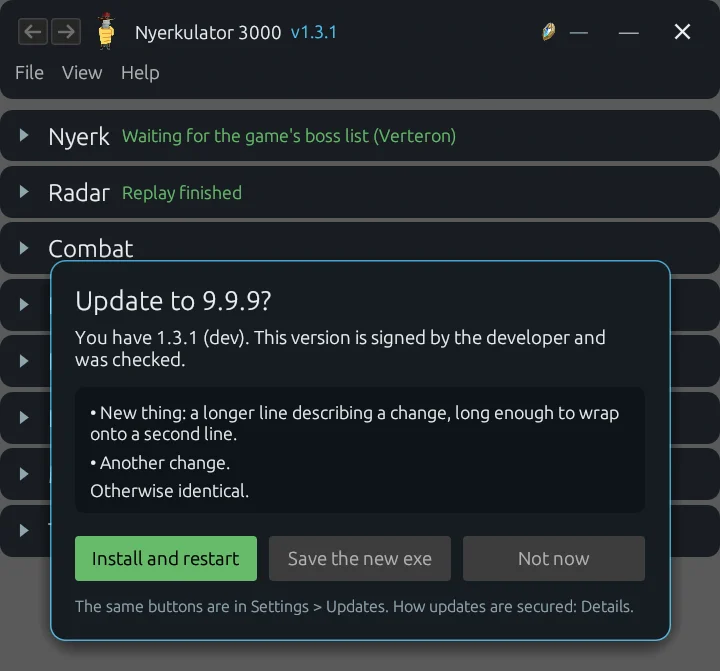

[Part 1](/blog/2026/ai-agent-platform-part-1) covered what the platform is and how the work splits between me and a team of 29 Claude Code agents. [Part 2](/blog/2026/ai-agent-platform-part-2) is about how those agents get code merged without tripping over each other. This part is about the scarier question: what happens *after* the merge, when the code has to land on a real host that real people depend on.

Here's the problem in one sentence. The agents need to look at production (is the server healthy, did that deploy work, how many errors in the last ten minutes) and they need to deploy, but I really, really did not want to hand a pile of language models a root shell on my homelab and a note saying "please be careful."

## Rules alone weren't enough

I'll be honest about how this started, because it's the whole reason the rest of this post exists. The first version of "agents can touch production" was rules. The agent definitions said what the agents were allowed to run on a host and what they weren't, and the expectation was that they'd stick to it.

The project's own gate README says it plainly: rules alone failed to keep agents inside their limits. Not in a dramatic, everything-is-on-fire way, more in the way any sysadmin who's ever written a policy doc already knows. A written rule is a suggestion to whoever's reading it. If something actually matters, it needs to be enforced by the system, not by good intentions. Same instinct as not trusting a firewall rule you haven't tested, or a backup you've never restored.

So the rules got turned into machinery. There are now two completely separate paths onto a host:

1. **Reads and routine deploys** go through a restricted SSH key that can only ever run one program.
2. **Anything that actually changes a host** gets queued, and nothing happens until I approve it with a passkey.

![Access control diagram. Left: the agents' SSH key is restricted to one root-owned gate program with a short allowlist of named commands like health, log counts, error locations, row counts, and primary-only deploys, while shells, sftp, port forwarding, reading secrets, and free-form scripts are refused. Right: host changes are queued by an agent, picked up by an unprivileged runner, summarized by a root helper on the host, approved by the owner with a passkey, verified and applied by the helper, and recorded in a hash-chained audit log](access-control.webp)

## Path one: the host gate

On each host, the agents' public key sits in `authorized_keys` with exactly one line, and it looks like this (wrapped here to fit; it's a single line in the real file):

```
restrict,command="/usr/local/sbin/nk-agent-gate"
  ssh-ed25519 AAAA… nk-host-behind-gate
```

If you haven't used these two options before, they're the whole trick. `restrict` turns off everything optional for that key: no port forwarding, no agent forwarding, no PTY, no X11. `command=` is a forced command, meaning that no matter what the client asks to run, sshd runs *that* program instead and hands it whatever the client typed as a plain string in `SSH_ORIGINAL_COMMAND`. The agent can type `bash`, `cat /etc/shadow`, or a whole poem, and what actually executes is the gate, which reads the string, decides whether it's one of the things it knows, and refuses everything else.

My own key is separate and doesn't go through any of this. The gate is only for the agents.

What the gate allows is a short list of **named** operations, not commands with arbitrary arguments:

- containers and versions,
- health for a given container,
- log counts by level over the last 10 minutes or 2 hours (counts, not lines),
- error lines for a stack, with sensitive bits masked,
- *where* errors are coming from, as code locations,
- database row counts,
- standby status,
- a deploy of one named service, on the primary host only,
- a handful of named reads for pyaaa, plus one job-plan input.

Everything else gets refused: shells, sftp, scp, port forwarding, PTYs, reading `.env` files, tokens, or member IDs, free-form scripts, and any deploy aimed at the standby.

The part I like most is the masking. Even the reads the agents *are* allowed to do get scrubbed on the host before anything leaves it. Tokens, IP addresses, emails, and IDs are masked out right there, so an agent debugging a crash gets "an error happened at this line in this file, 14 times in the last 10 minutes" and not a log line with someone's Discord ID in it. Production reads without production data, basically.

That one input I mentioned, the job plan, is the only place the gate takes anything resembling free text, so it gets the most suspicion. It's rebuilt field by field instead of being passed through as-is, run through strict checks, and then pyaaa holds it until I click to let it run. If you've ever had to sanitize user input, it's the same idea, just with the "user" being an AI that is very good at producing plausible-looking strings.

The gate itself is versioned and tested like any other code. It has its own test script that runs as part of every full check, its files only change in a reviewed PR that bumps `GATE_VERSION`, and installing a new version on a host goes through the passkey path below rather than the gate approving its own upgrade. At the time of writing it's on its 19th version. Not every version was a security improvement, either. Gate 8, for example, was mostly fixing image repository names that had been making the gate refuse perfectly legitimate agent deploys. A gate that's too strict just gets worked around, so getting the boring parts right matters too.

## Path two: passkey approvals through a server I don't trust

Deploys of a known service are one thing. Installing a new gate version, changing a host's config, anything with real blast radius, that needed a human. Specifically me. And I wanted to be able to approve it from my phone, because I am not always at my desk when an agent decides it's time to ship something.

The obvious way to build that is a nice web page on the server with an "Approve" button. The problem is that this makes the web server the thing you're trusting. If the server gets compromised, whoever owns it can show me one thing, approve another, or just press the button themselves. So the design flips it around: **the server is untrusted on purpose**. It only queues requests and carries messages. It doesn't get to decide anything.

Here's how a request actually flows:

1. **An agent queues a named operation.** Typed parameters only, no free text. Each agent is capped at 3 open requests and 10 a day, with a separate cap of 8 a day per host, and requests expire after 24 hours.
2. **An unprivileged runner on the host picks it up.** It polls the server's queue outbound, so the host still exposes nothing. The runner has no privileges, decides nothing, and holds no webhook. It's a courier.
3. **A root helper on the host writes its own summary.** It checks the request against its own catalog of allowed operations, then writes a summary of exactly what *it* will do, signs it, and sends it to my Discord, followed by a short code.
4. **I approve on my phone.** I sign in to the staff console, paste the code from Discord so I know I'm looking at the same request the host described, and approve with a passkey (WebAuthn). The passkey signs the host's summary, not anything the server made up.
5. **The helper verifies and applies.** The root helper checks the passkey signature itself and acts only on its own stored summary. A deploy that isn't confirmed within its window gets undone automatically.
6. **Everything gets logged.** Every event lands in an ops log where each row's hash covers the row before it, so nobody can quietly edit history after the fact.

The checks on that page aren't written by the server either. They come from the host. And if one fails, the page doesn't give me the option to approve at all, only to decline. Flagged install diffs get one more guard: the console shows the diff with its verified SHA-256 and every line verbatim, and tells me to read the copy the host sent to Discord, because that's the one I'm actually approving.

{{< carousel images="{c-ops-approve.webp,c-ops-check-failed.webp,c-ops-diff.webp}" captions="{c-ops-approve.webp:An ops request with five host-written checks passing and the passkey approval (demo data and host name hidden),c-ops-check-failed.webp:The same request with a failed check where approval is hidden and Decline is the only option,c-ops-diff.webp:The install diff viewer with the verified sha256 and every line shown verbatim (test fixture)}" aspectRatio="16-9" interval="7000" >}}

I like this a lot, mostly because I know myself. At some point I'll be half-asleep, an agent will want something, and I'll be tempted to just tap Approve. Hiding the button when a check fails takes that decision out of my hands. The flagged-diff guard goes one step further: the console makes me type a check value from the end of the diff before it'll let me approve, which is a polite way of making sure I actually scrolled to the bottom.

The end result is that a compromised runner, server, or console can queue requests and show me things, but none of them can make the root helper run anything my passkey didn't sign.

### The requests that could never run

This system had growing pains too, just not the ones I expected. A post-mortem of every refused or failed host request counted 13, and **none** of them was a safety refusal stopping a bad change. They were agents asking blind about things they couldn't see on the host, and hosts saying no for boring reasons. The fix was giving agents better information before a request ever reaches me, and I go through it in [Part 2](/blog/2026/ai-agent-platform-part-2).

Lesson learned, and it's an old one: if every request that reaches the approver is either obviously fine or obviously broken, the approval step is mostly noise. Push the obvious checks as early as possible so the human only sees requests that actually need a human.

## Deploys can only run what I approved

The other half of "can only run what I approved" is the images themselves. Images get built from clean checkouts of the merged commit and pushed to GHCR. That part's normal. What isn't normal is how they get deployed.

A tag like `latest` is a pointer, and pointers move. If a deploy just pulls `latest`, it's running whatever that tag pointed at in the moment, which might not be the image I looked at. So deploys are pinned by **digest**, the image's SHA-256. A deploy restarts only the exact GHCR digest I approved, and it refuses outright if the compose file doesn't match. That's what those host-written checks in the console are verifying: compose is pinned to the digest, compose resolves to that image, the image was pulled by digest, and the image names its commit.

The containers themselves are locked down about as far as they'll go:

- **No published ports.** The server's only way in is a Cloudflare tunnel, sitting on an internal network with no gateway. Every stack gets its own tunnel, token, and network.
- **Non-root, read-only, distroless.** Containers run as a non-root user on a read-only distroless image with all Linux capabilities dropped. There's no shell in the image to drop into even if someone got code execution.
- **Pinned dependencies.** Even cloudflared is pinned to a specific version (2026.10.3) instead of floating.
- **A gated admin API.** The server's admin endpoints (`/api/v1/admin*`) sit behind a Cloudflare WAF rule that blocks any request missing a secret header. So even if an admin token leaked somewhere, it wouldn't open the API from the open internet on its own.

None of this is exotic. It's the same defense-in-depth checklist you'd want on any internet-facing service. The difference is that I wanted every layer to still hold if one of the others failed, since the "others" now include a team of agents shipping dozens of changes a day.

## The standby host

For a while, all four services ran on one box with no tested way to fail over. That's fine right up until it isn't, and with real people using the app every day it stopped feeling fine.

The fix started with a live migration to a new host, done as scripted `prepare`, `cut`, and `finish` steps, with a SHA-256 check of each database. The actual cuts each took **under 75 seconds**, image pulls included. Then a second Proxmox host became a standby:

- **Litestream sidecars** stream every SQLite database's changes to a receiver on the standby, keeping it about **one second behind**. The receiver accepts SFTP with a pinned key only.
- **Everything that isn't a database** gets copied every 10 minutes.
- **Each standby stack has its own Cloudflare tunnel**, and the standby stacks stay stopped, pinned to the same image digest as the primary. Only one copy ever writes.
- **A restore test runs every night.** It runs an integrity check on the copy and actually boots tonight's image on it, because a backup you've never restored is a hope, not a backup.

I want to be precise about one thing, because it's easy to oversell: the standby does **not** take over automatically. If the primary dies, a script moves the hostnames over to the standby's tunnels. It's a scripted switchover that I run, not automatic failover. For a community platform this size, I'd rather have a fast, tested, boring manual switch than an automatic one that might decide to fail over during a network blip and leave me with two copies both thinking they're in charge.

To find out what a real crash would actually cost, I ran a hard-kill trial under write load: kill the primary mid-stream and compare what the standby has against what was acknowledged. Out of 1,435 acknowledged writes, **37 were lost**, and the newest lost write was from **0.74 seconds** before the kill. So a sudden power cut loses roughly the last second of writes. That matches the "about a second behind" figure, and now it's measured instead of assumed.

The standby also produced a good bug. At one point the receiver went into a crash loop, 10 restarts in about 110 seconds. It was traced back to the receiver not being re-created with the senders' new keys, and the fix went into the setup script so that step can't be skipped again.

## Protecting the people running the app

Everything above protects my hosts. But the bigger responsibility is the dozens of people running Nyerkulator on their own gaming PCs, because an in-app updater is about the most dangerous feature an app can have. If an attacker can control what the updater installs, they get code execution on every machine running the app.

So the rule for updates is that **nothing between me and the user gets to decide what's installed**. Not the server, not Cloudflare, not DNS, not the network.

Each release has a manifest with the version, the SHA-256, the size, and an expiry date 180 days out, and that manifest is signed with an Ed25519 key that never leaves my PC. When the app sees an update, it checks the signature, the expiry, the version, the size, and the hash. Only then does it ask the user. If they say yes, it swaps the exe, and if the new one doesn't start, it rolls back to the old one.



The expiry is the part people tend to skip. Without it, an attacker who got hold of an old, validly signed manifest could replay it forever to push users back onto an old version with a known bug. With a 180-day expiry, old manifests eventually just stop being accepted.

The beta channel had its own versioning saga, where testers on a beta could never be offered the stable release that came after it, and fixing it without needing the signing key anywhere near the server took some creative bridging. That one's in [Part 2](/blog/2026/ai-agent-platform-part-2).

## What the admin side looks like day to day

Everything so far is about how changes get *onto* a host. The other half of running a platform is knowing what it's doing once they're there, and for that there are two places I look: the website's admin pages, and the staff console.

### The website's admin pages

The admin pages live inside the members site, visible only to owners, and they're split into tabs:

- **Overview** is the dashboard I open first: server version and uptime, how many apps are active now and today, which app versions are out there and sharing finds, how many members signed in, how much data the database holds, and how fast the disk is filling. It also keeps a row for old Cube Radar builds, which the server now refuses, so I can see whether anybody is still stuck on one. If free disk drops under 15%, or the database, app logs, or combat records start growing at over three times their recent daily average, an alert goes to the server's log at most once a day.
- **Usage** is where the adoption numbers in this series come from: 54 monthly active installs, 27 monthly signed-in members, and 27 linked accounts. Those totals are real. The 90-day daily curve in the screenshots is generated demo data.
- **Access** decides who may sign in at all (by Discord role, an allow list, or any member of the server), which app features need which level, and who may edit the legion roster. Sign-ins last 7 days after their last use and 30 days at most, changed rules reach signed-in members within about five minutes, and there's a big red **Sign everyone out** button for when that isn't fast enough.
- **Signed-in apps** lists every app sign-in with its features and link state, with a revoke button on each.
- **Logs and recordings** is where a bug report starts. A member gives me a code from the app's Status and logs window, and I can find the log they uploaded, search app logs, or pull a developer recording of a session. Logs arrive already scrubbed on the member's PC, and they're kept for 30 days.
- **Traffic** shows requests per route, error rates, and the live server log.
- **Moderation and cleanup** covers the rest: merging misread item names and removing bad entries in the market data, reviewing the DPS meter banner images members upload (and pausing an account if needed), and the legion chat relay's own page with reader health, characters the reader doesn't know yet, and join applications. There's also a version of the leaderboard *with* names, which exists purely for owners troubleshooting. Members never see it.

{{< carousel images="{a-overview.webp,a-usage.webp,a-logs.webp,a-status.webp}" captions="{a-overview.webp:Admin overview with server and players and app versions and how apps update (demo data),a-usage.webp:Admin usage with the real totals over a generated 90-day daily curve,a-logs.webp:Logs and recordings where uploaded logs and developer recordings are found,a-status.webp:The public status page with uptime measured from inside and through Cloudflare}" aspectRatio="16-9" interval="7000" >}}

The last slide is the one page here that isn't private. The public status page shows 24-hour and 90-day uptime, measured two ways: from inside the server, and through Cloudflare the way a member actually reaches it. When one is green and the other isn't, that says whether the problem is the server or the path to it.

### The staff console

The staff console is separate from the members site and sits behind Cloudflare Access. Its home page shows each app's state, alerts, and totals at a glance, each app has a detail page with its own log, and the console log records every action along with which Access and Discord accounts are linked. Linking a Cloudflare Access account to a Discord account is its own small page, and so is enrolling the passkey that approves owner operations. Completed requests keep their outcome, the host's report, and the full log, so "what happened to that deploy last Tuesday" has an answer.

None of this is glamorous. It's the same set of screens any ops team ends up building: what's running, who's using it, who's allowed in, what broke, and where the logs are. The difference is that the agents built it to my spec, and I'm the one who uses it every day.

## What I'd tell anyone else doing this

A few things I'd carry into any setup where automation, AI or otherwise, gets near production:

- **Enforce, don't ask.** If a rule matters, make the system enforce it. `restrict,command=` is decades-old OpenSSH and it does more for safety than any amount of careful wording in a prompt.
- **Give out named operations, not commands.** "Health of this container" is easy to reason about. "Run this command" isn't.
- **Don't trust the middle.** The server carries messages. The host decides, and the host checks the signature itself.
- **Make the safe choice the easy one.** Hiding the approve button on a failed check is a tiny UI detail that removes a whole class of tired-human mistakes.
- **Measure your recovery story.** "About a second behind" is a claim. "37 of 1,435 writes, the last 0.74 seconds" is a measurement.

The repos are private and the whole thing is still very much in active development, so all of this is a snapshot, not a finished design. The gate is already on version 19 and I doubt it stops there.

Next up in [Part 4](/blog/2026/ai-agent-platform-part-4): how the app reads the game without ever touching it, kept high level, and some of the odd things passive capture turned up, like mobs teleporting to coordinates that can't exist.
