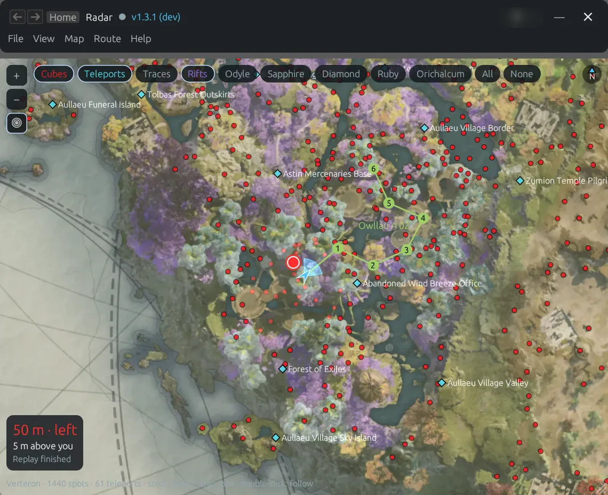
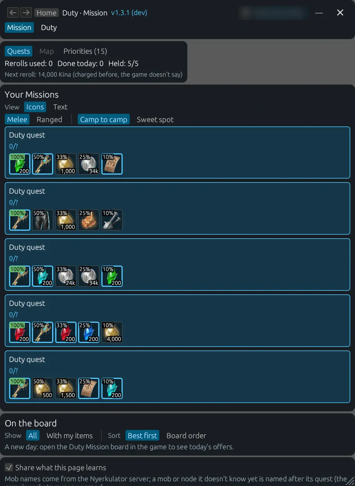
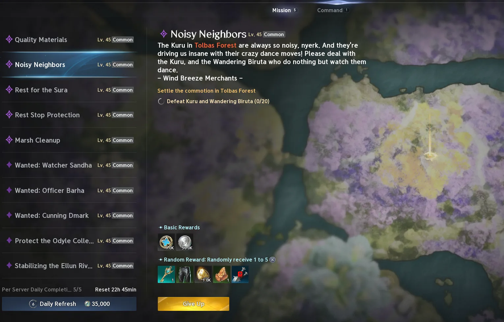
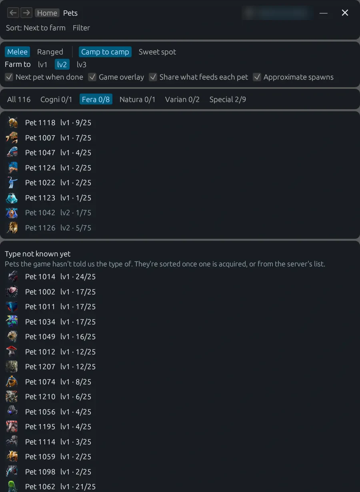

## Only allowed to watch

Back in [Part 1](/blog/2026/ai-agent-platform-part-1) I said the one rule that matters more than any feature is that Nyerkulator reads the game **passively**. It watches the game's own network traffic on your PC through Npcap, it reads the screen for things like the minimap and the chat box, and that's the whole list. No touching game memory, no injecting anything, never sending the game a single packet.

That rule is easy to write down and annoying to live with. Every tool in the app, the cube radar, the Duty quest board, the pet tracker, the boss timers, has to work out what's going on from two sources: whatever the game happens to say over the wire on its own, and whatever's visible on screen. You never get to ask a question. You only get to listen and look, and then decide what you think it meant.

I'm keeping the protocol details out of this on purpose. Nobody needs a byte-by-byte tour, and honestly it isn't the interesting part. The interesting part is what happens after you can read *something*: the moment where the data you're reading is wrong in a way that looks right, or right in a way that contradicts what everybody assumed about the game. This post is a handful of those.

Same disclaimer as the rest of the series: the code here was written by Claude Code agents under rules I set, and I directed, tested and approved it. The repos are private and still in active development.

## Recordings are the whole trick

Before any of the war stories, the one decision that made all of them solvable: **we record the game's traffic and replay it**.

With dev mode on, the app can save a capture of a play session. Later, the same Windows build can be pointed at that file instead of a live network adapter, and it runs every tool exactly as if the game were open, at any speed, as many times as you like. A replay never contacts the server, and every tool is open without signing in, which makes it perfect for two things:

- **Screenshots.** Every app screenshot in this series is a real render from a replay, not a mockup. That's also why some of them look a little odd: quest, pet and mob names come from the server's catalog, which a replay doesn't fetch, so they show up as "Duty quest" or "Pet 1118."
- **Proof.** A bug report becomes a recording, the recording becomes a test, and a fix isn't done until the replay prints the right answer. For refactors, a whole pile of real recordings get replayed through the old build and the new build, and the outputs have to match. That's the backbone of [Part 6](/blog/2026/ai-agent-platform-part-6), where it gets run against 141 recordings and 4.7 million packets.



When you can't ask the game anything, a recording is the closest thing you get to a second opinion. You can stare at the same five seconds of traffic as many times as it takes.

## Mobs teleporting to coordinates that can't exist

The hunt map is the part of Radar that shows mobs around you, which feeds the routing for Duty quests and Pets. At some point it started showing mobs "moving" to spots that made no sense. Some jumped to almost exactly the center of the world. Others flew off the edge of the map entirely.

The tell was in the kill log. Out of my own kills in a single day, **26** had positions that looked like this:

```
(-2.5e-21, -0.0019)
x ≈ 1e-38
```

If you've ever seen numbers like that, you know that's not a mob standing somewhere strange. Those are the kind of values you get when you read the right bytes from the wrong place: a few bytes of something else, interpreted as a floating-point coordinate. It's garbage that happens to be a valid number, which is the worst kind of garbage, because nothing crashes. The map just quietly draws a mob at the origin of the universe.

The cause turned out to be small and very specific. Mob movement updates carry a flag for certain kinds of movement, like flying or turning, and when that flag was set, the parser was reading the following fields **one byte early**. Every mob that walked normally was fine. Every mob that flew or turned got its position read from slightly the wrong spot. Which is exactly why it looked intermittent instead of totally broken.

The fix had two halves, and the second half is the one I actually care about:

1. **Skip the byte.** When the flag is set, the parser now steps over it before reading the position.
2. **Check at the boundary.** Positions get sanity-checked the moment they come in, before any tool sees them. Anything non-finite or outside the map's range gets dropped. And any jump faster than **40 m/s** is held instead of trusted, until the next movement update either confirms it or doesn't.

After the fix, all **2,137** of those flagged movement updates in the capture lined up with their mob.

The boundary check is the part that would've saved us in the first place. It's the same instinct as validating input on any server: don't let the code three layers in be the first thing to notice the input was nonsense. A mob can't cover a few hundred meters in a blink, so the code shouldn't believe that it did, no matter how confidently the parser says so. Lesson learned: if the data comes from somewhere you don't control, decide what "impossible" means and enforce it at the door.

## Do mobs actually respawn in the same place?

This one wasn't a bug, it was a question the routing needed answered. Pets and Duty quests both send you off to farm specific mobs, and a good farm route depends on two things nobody had real numbers for: do mobs come back at the same spot, and how long does it take?

We had recordings, so instead of guessing, we measured it. Every death in **14** recorded sessions was paired with the next time a mob of the same kind appeared within 150 m. That came to **1,153** deaths in view.

The results were cleaner than I expected:

- **Respawns come in fixed steps.** 5.2 seconds, 29.2 seconds, 54.2 seconds, and then every 25 seconds after that. Out of 686 timed pairs, **653** landed within 50 milliseconds of a step. That's not "roughly every half minute," that's a timer.
- **Mobs come back where they were.** The median distance between where a mob died and where it came back was **0.0 m**, and **81%** came back within a meter.

Those numbers went straight into the model that plans farm routes. If mobs reliably come back in the same place on a known schedule, the best loop isn't "wander toward the nearest red dot," it's a circuit timed so you arrive at each camp right as it refills. That's the job of the farm-route model behind the hunt options on the Duty and Pets pages.



## Who actually gets credit for a kill

The other thing captures settled was an argument with our own code.

The Duty quests tab counts your progress on each mission, the "Defeat 20 of these" kind. The counter sometimes ticked on kills the app said belonged to someone else. The obvious assumption was that the app had attributed a kill wrong.

It hadn't. The game was doing something we hadn't assumed: it credits a Duty kill to **everyone who hit the mob**, not just whoever landed the last blow. The recordings made that hard to argue with. In one of them, **15 of 91** of my mission ticks came 48 milliseconds after *another player's* kill of a mob I had hit. Same mob, their kill, my counter.



So instead of "fixing" the counter into agreeing with our wrong model, the app got a new kind of event, **Assisted**, for exactly this case. It counts toward Duty, because the game counts it toward Duty.

And then the twist: it does **not** count toward Pets. Pet progress comes from souls you collect off kills, and the same recordings showed the game is a lot stingier there. Own kills gave souls 62 times in 142. Assists gave them 3 times in 19. Different system, different rules, and if we'd generalized "assists count" from the Duty finding, we would've broken the pet tracker in the process.



That's the theme of this whole post, really. When you're only watching, your model of the game is a guess, and the guess is only as good as the last time you checked it against a recording. "The counter is wrong" turned out to mean "our model is wrong," and the fix was to change the model, carefully, only where the evidence said so.

## The small ones

Not every bug was a deep mystery. Some of my favorites were small, user-reported, and came down to the app assuming the game would keep doing the thing it did last time.

**Position froze after an event zone.** This one goes back to the Cube Radar days. After a trip into an event zone, a player's position just stopped updating. It turned out that moving into the zone puts you on a different game server, and on that server your character has a **new id**. The app had learned your id once and kept looking for the old one, so as far as it was concerned, you'd stopped moving forever. Now the id gets worked out again from regular traffic on every new connection or map, instead of being remembered from the first one.

**Radar thought the game wasn't in front.** Minimap marks froze while a user was actively playing, because Radar decided the game wasn't the foreground window. The game, it turns out, switches between windows of its own. Radar was watching one of them. It now follows whichever game window is actually in front.

**Opening Status and logs froze the whole app.** Since version 1.2.0, clicking into the Status page could lock the app up. The Nyerk tab's status lines were waiting on themselves, a classic deadlock wearing a very boring hat. Not a game-reading bug at all, but it lives in this section because it came in the same way as the rest: a user report, a reproduction, a fix.

**Uploaded logs carried the Windows user name and computer name.** This is the one I'm most glad got caught. When a user sent logs for a bug report, file paths in those logs included their Windows user name and their PC's name. Neither is any of my business. Both are now masked on the user's PC as `<home>` and `<pc>` before anything gets uploaded. If you're building something people install on their gaming PC, the bar is that it doesn't phone home with anything you couldn't justify out loud, and the app has a plain-language page that says exactly what it shares.

## The screen fills in the gaps

One more piece worth mentioning, because it sets up the next post. The traffic tells you where things are, but not continuously. The game sends the player's position every so often, and between those updates you're blind if traffic is all you've got. That's not good enough for an arrow on screen pointing at a cube 50 meters away.

So the other half of passive reading is the screen. Radar reads the game's minimap, specifically the camera cone and how the map moves, up to 60 times a second, and uses that to turn and move the map and the on-screen pointer in between position updates. Traffic gives you the anchor points, the minimap fills in the motion.

It works great, right up until something on screen looks a little too much like a minimap. [Part 5](/blog/2026/ai-agent-platform-part-5) is the story of Radar deciding the HP bar was a minimap, and everything it took to talk it out of that.

## What I took from all this

If there's one habit this part of the project hammered in, it's the same one from the Palworld build, just with higher stakes: **tell "I assumed this" apart from "I verified this."** Every bug in this post came from one assumption that looked reasonable. The flag doesn't change the layout. Mobs probably respawn randomly. A kill belongs to whoever landed it. Your character id stays the same. The game has one window.

And the habit that fixed every one of them was the same, too: get a recording, replay it, measure, and only change the model where the evidence says so. Checks at the boundary for anything you didn't produce yourself. Numbers, not opinions, before routing gets built on top of something.

Next up, [Part 5](/blog/2026/ai-agent-platform-part-5): the minimap, user reports 7, 8 and 9, and teaching Radar what a minimap actually looks like.
