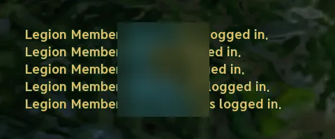

[Part 1](/blog/2026/ai-agent-platform-part-1) covered what the platform is and how the work splits between me and the agents. This part is about the least glamorous and most humbling part of the whole project: user reports. Specifically, a run of them that all came back to the same small rectangle in the corner of the screen, the minimap, and one about the chat box that I still think is kind of funny.

Quick reminder of the ground rules, because they're the reason any of this is hard. Nyerkulator reads the game passively. It watches the game's network traffic and it reads the screen, and that's all. It never touches game memory, so there's no "just ask the game where the camera is pointing." If the app wants to know which way you're facing, it has to look at the minimap like a person would, and work it out from the picture.

## Why the minimap matters so much

The game tells the app where the player is, but not constantly. Position comes in through the traffic every so often, and in between those updates the app would otherwise be guessing. So Radar reads the minimap's camera cone, up to 60 times a second, and uses it to turn and move its own map and the screen pointer between position updates. The minimap also feeds a motion tracker that follows how the map scrolls under the player marker, which is how the dot keeps moving smoothly instead of teleporting from one position update to the next.

That's the happy path: default layout, minimap in its usual top-right spot, game window in front, nothing covering it. Every report in this post is someone stepping off that happy path in a perfectly reasonable way, and Radar falling over because of it.

The reports were numbered, and they came with a description and, where possible, screenshots, videos or a debug dump from the app. The reporters' actual screens became test fixtures in the repo, so every fix had to pass on the exact picture that broke it, and every future change has to keep passing on it too. That last part matters more than it sounds. Without it, fix number three quietly undoes fix number one and nobody notices until the same person reports the same bug again.

## Report 7: the minimap was reading a browser

The first one sounds silly once you know the answer. Minimap marks, the screen pointer and the distance to a cube all went wrong for someone while a browser window was covering part of the game. The reason: the app was copying pixels off the screen where the minimap *should* be, and when a browser was sitting on top of it, it was very faithfully reading the browser. It tried its best to find a camera cone in a web page and, unsurprisingly, came up with nonsense. On top of that, a minimap that had been moved or resized in the game's settings broke readings too, since the app assumed the default spot.

The fix had two parts:

- **Check before you read.** Before trusting the minimap pixels, the app asks Windows what's actually on top at that spot with `WindowFromPoint`. If something other than the game covers the minimap, it doesn't read the screen copy.
- **Read the game's own picture instead.** When the game is covered, the app grabs the game window's own frames through Windows Graphics Capture, which gives you what the game drew regardless of what's on top of it. If that isn't available, the app skips the reading entirely rather than guessing.

That second bullet is a pattern I keep coming back to across this whole project: when you don't know, say you don't know. A skipped reading costs a fraction of a second of slightly less smooth movement. A wrong reading sends the arrow pointing at a rock.

To deal with moved and resized minimaps, the app also searched for the minimap box instead of assuming where it was, and threw out lookalike boxes using **edge density**: the share of pixels in a box that have a strong brightness step. The thinking was that a minimap is mostly smooth map texture, while busier UI elements are full of hard edges. Reasonable idea. It held up for a while.

## Report 9: it thought the HP bar was a minimap

Then report 9 came in, and it's the reason this post exists. Someone had made their minimap smaller and moved it to the bottom left, on a 1920x1080 screen. Radar didn't find it. Worse, it found something else and was confident about it: first the quest tracker, then the HP bar, and it read a constant camera direction off of them for minutes at a time. After a resize to 2560x1440, it moved on to following the skill bar for about a minute.

Here's the detector's real output on the screen from that report, before and after:

Look at the numbers along the bottom left of that slide. The lookalikes measured 41 to 44% edge pixels, and the real minimap measured 33%. That's not a gap you can put a cutoff in with any confidence. The 1440p screen from the same report was worse:

Real minimap at 26%, skill bar boxes at 33% and 28%, quest tracker at 32%. Across these screens the real minimaps landed between 26 and 33% and the lookalikes between 28 and 44%. The ranges overlap. Edge density just can't tell them apart once the minimap gets small and the rest of the HUD is busy, and no amount of tuning the threshold was going to fix that. The inset in the bottom left is the app's own debug dump from version 1.2.x, showing the skill bar boxes it was happily following. That dump is a big part of why this got fixed properly: it showed exactly what the old detector believed, instead of me having to guess.

### Finding it by its icons instead

The question that unstuck this was simple: what does the minimap have that nothing else on screen has? Not texture, not edges, not a rough shape. It has **icons on its frame**. A map icon in the top corner, a pair of swap arrows in the bottom corner, a bookmark star beside it. Those exist around the minimap and nowhere else, at any size and any position.

So the detector changed from "find a box that looks like a map" to "find these three icons," searched over a wide range of scales, from 720p up to 1440p. Once the icons are found, they pin down the map's box. The player's marker disc in the middle then gives the exact center and the zoom level from its size.

Here's the same 1440p screen that chased the skill bar, run through the new search:

The scores on that screen are worth a look too: swap arrows 1.00, star 0.62, map icon 0.55 because the game draws it highlighted there. Not every icon is a perfect match on every screen, which is exactly why the detector uses three of them instead of betting on one.

A few more rules came along with it, all aimed at not getting fooled again:

- **Trust has to be earned.** A box found outside an area that's already confirmed, or one the user framed by hand, is only trusted once it *behaves* like a minimap: the same box and marker disc seen at least 3 times over 1.5 seconds, while the player is turning or scrolling. An HP bar doesn't have a marker disc that rotates when you turn the camera.
- **Read the camera around the marker, not the box.** The camera direction is now read around the player's marker disc instead of the center of the box. If the box is a few pixels off, the reading stays right.

On report 9's screens, the marker now lands within 1.5 pixels of the map center.

### "If the HUD moves, the overlay stops working for the minimap"

That's the follow-up report, from me this time, and it's a good example of a fix being right but not finished. With the icon search in place, the app found the minimap correctly. But if you moved the HUD mid-session, re-finding the minimap afterward took **almost two minutes**. The app kept holding on to the minimap's old position for far too long before going looking for it again.

The fix: as soon as a lock loses its frame icons, it's released immediately, and the whole window gets searched by those icons right away, then on a backoff schedule if nothing turns up. The icon search takes about 0.3 seconds at 1080p, and a whole-screen search on a 4K screen comes in around 60 ms. Two minutes to well under a second, for what's basically "stop holding on to something that isn't there anymore."

## Report 8: the dot ran ahead and snapped back

Report 8 was a different kind of wrong. The minimap was found fine. The player's dot on Radar's map would run ahead of where the player actually was, and then snap back 20 to 25 meters every time a real position update came in from the game. Run, snap, run, snap.

This one came from the motion tracker I mentioned at the top, the part that follows how the minimap scrolls to fill the gaps between position updates. To turn "the minimap scrolled this many pixels" into meters, it needs to know the minimap's scale. An older tracker had been *learning* that scale over time, and it had learned it badly: 30,446 units per minimap width, where the real value is about 20,300. About 50% too big. So every bit of movement got stretched by half, the dot sprinted ahead, and the next real position yanked it back. On top of that, tracking was getting lost about a third of the time while riding over plain ground, where there isn't much on the minimap texture to follow.

The fix:

- **Throw out the old learned scales.** Anything learned by the old tracker got discarded instead of trusted.
- **Only re-measure under good conditions.** The scale is now re-measured only over unbroken stretches of up to 30 seconds, and only to values the minimap's zoom levels can actually produce. If a measurement says something the game can't do, it's wrong, and it gets ignored.
- **Carry on instead of starting over.** When the older reference image fades out, the tracker continues from the latest minimap frame rather than resetting, which is what was losing it on plain ground.

The reporter had two riding videos, about 80 seconds and 4,800 frames in total, and they became the test. On those, the minimap is now followed on **100% of frames**, up from 64%. The average path error, which had been 12 to 13 meters and up to 33, dropped to **1.2 to 1.8 meters**. The jump when a real position comes in is now at most 3 meters, which on a map you're glancing at while playing is basically invisible.

That "only values the game can produce" rule is one I'd recommend to anyone doing measurement off of real-world data. A learned value with no sanity bounds will eventually learn something wrong, and then it'll be confidently wrong for the rest of the session.

## The chat box that said "nopefully"

The last one isn't the minimap, but it's the same kind of problem and I couldn't leave it out. One of the tools is the Legion chat relay, which reads our legion's chat off the screen and posts it into a Discord channel. It's OCR, more or less: it matches each character in the chat box against the game's own font.

A user report on October 30th: sometimes the bot posted a run of `□` boxes instead of a message, or swapped letters, so "hopefully" came out as "nopefully." The cause turned out to be the game itself drawing things on top of the chat. When a world nameplate, for example "Water Spirit," was drawn over a chat line, its letters got mixed in with the chat's letters, and the OCR did its best with a picture that was now two pieces of text on top of each other.

You can't stop the game from drawing nameplates, so the fix is about noticing when it happens:

- **Spot the overlay.** Nameplates have thin, dark-outlined strokes in strong colors the chat never uses. A line with at least 12 pixels of that gets marked as overlaid. For a sense of the margin, the research captures of clean chat have at most 6.
- **Wait it out.** An overlaid message isn't posted right away. It waits until the nameplate has moved off the line.
- **Never post a guess.** If the overlay is still there after about a minute, the message is skipped and logged. It's never sent as read. Same rule as the minimap: a missing line is better than a wrong one in a channel people actually read.

There was a related fix for characters the bot's copy of the font didn't have yet. Those get named once on an admin page, the names on the legion roster act as votes for what each one probably is, and the bots pick up the result.

The chat reader also got a lot faster around the same time, 14 times faster with output that stayed identical on every test image. That's a story about proving a speedup doesn't change anything, so it's in [Part 6](/blog/2026/ai-agent-platform-part-6).

## What I took away from these

None of these bugs were exotic. Someone covered the game with a browser. Someone moved their minimap. Someone rode a mount across a field. Someone was chatting while a monster walked past. That's just people playing the game, and every one of them broke an assumption that only held on my own setup.

A few things I'd do the same way again:

- **The reporter's screen is the test.** Every one of these fixes was checked against the exact pictures or videos from the report, and those stayed in the repo as fixtures. The before and after images in this post are the detector's real output on those same screens, not mockups.
- **Debug dumps pay for themselves.** The 1.2.x dump showing exactly which boxes Radar was following turned report 9 from "it's broken for me" into a precise picture of what the detector believed. If your tool reads the world, make it easy for users to show you what it saw.
- **Pick features that only the real thing has.** Edge density described something lots of UI elements share. The frame icons described something only the minimap has. Most of the robustness came from that one change in what we were looking for.
- **Say "I don't know" instead of guessing.** Skip the reading when the game is covered. Don't trust a box until it behaves. Ignore a scale the game can't produce. Don't post a chat line you couldn't read cleanly. Almost every fix here was some version of that.

And on the AI side of things: the agents wrote these fixes, but handling the reports, reproducing the bugs, deciding what "fixed" meant and checking the result in the actual game were on me. That split works well for bugs like these. The detective work of "what's actually different about this person's screen" is where most of the time goes, and once that's written down clearly with the right test images attached, the implementation is the comparatively easy part.

Next up in [Part 6](/blog/2026/ai-agent-platform-part-6): making the app a lot faster in a bunch of places while proving, test image by test image and recording by recording, that not a single output changed.
