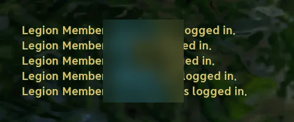
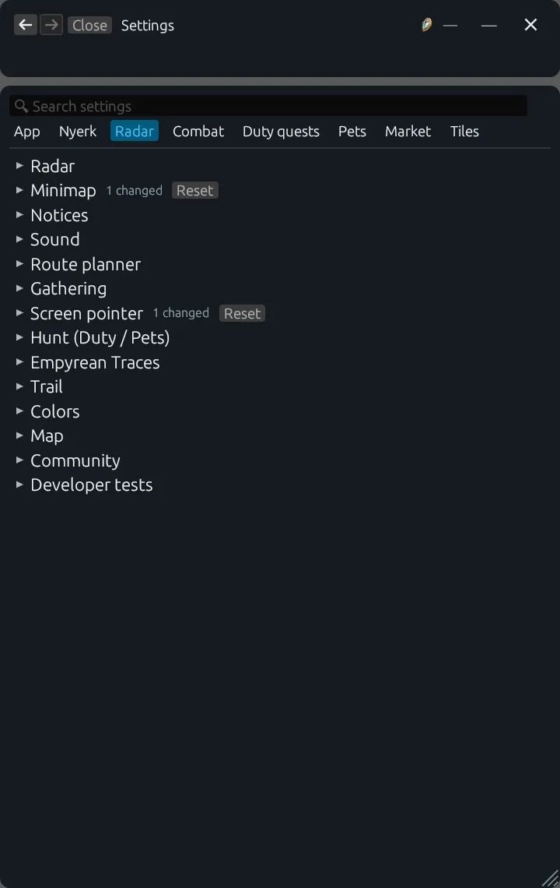

## Fast is easy, same is the hard part

If you've followed along since [Part 1](/blog/2026/ai-agent-platform-part-1), you know Nyerkulator 3000 is a desktop app that sits next to Aion 2 all session long, reading the game's network traffic and parts of the screen. Which means it's running on people's gaming PCs for hours at a time, competing with the actual game for CPU. Nobody wants a companion app that makes their game stutter, and nobody wants one that quietly gets *worse* at its job after an update either.

Here's the thing about handing performance work to AI agents: they're very good at making code faster. They're also perfectly capable of making code faster *and slightly wrong*, in a way that looks fine in a quick test and shows up three days later as a user report about a minimap marker drifting or a chat message coming through as gibberish. [Part 5](/blog/2026/ai-agent-platform-part-5) is a whole post of those reports, and every one of them took real detective work to pin down. A speedup that changes the answer isn't a speedup, it's a new bug with a nice benchmark attached.

So the rule for every optimization in this post was simple to say and annoying to satisfy: **the output has to be identical to before.** Not "close enough," not "the tests still pass." Identical. Every change was a refactor checked against bit-for-bit golden tests and identical replay output, and the timing numbers only counted once that check came back clean.

This part walks through four of those changes: the chat reader, the minimap search, what the app does when you're not using it, and how many times each packet got decoded. The numbers all come from the project's performance notes and changelog.

## The guardrail: golden tests and replays

Quick detour on what "identical" actually means here, since it's the whole point of this post.

A lot of this app's behavior can be recorded and replayed. The game's traffic gets saved as a capture file during a real session, and the app can be pointed at that file instead of a live game and fed the whole session again. Same packets in, so the same answers should come out. A replay never talks to the server, so it's safe to run as many times as you like. Screens work the same way: the screen-reading code can be run against saved screenshots instead of the live window.

That replay mode does double duty, by the way. Every screenshot of the app in this series was rendered from one: the app run with a capture file instead of the game, plus a built-in screenshot aid, either replaying one of my real sessions or a synthetic demo session. [Part 8](/blog/2026/ai-agent-platform-part-8) has more on that. The point here is that the same machinery that makes clean screenshots also makes a really strong test.

Before a refactor, run the old build over a pile of recordings and saved screens and keep what it produces, the "golden" output. After the refactor, run the new build over the same pile and compare. If a single result differs, the change doesn't merge until someone can explain exactly why.

The nice thing about this from my side, as the person approving merges and not writing the code, is that it turns "trust me, it's the same" into something I can actually check. I don't have to read every line of a vectorized image search to know whether it changed behavior. The comparison tells me.

## Chat OCR: 14 times faster, byte-for-byte the same

The Legion chat relay, Legion Feed in the app, is one of the more useful features for the community. It reads our legion's chat straight off the game screen, and the server posts each line into Discord under the character's name ([Part 9](/blog/2026/ai-agent-platform-part-9) covers the Discord side). Since the app never touches game memory, "reading the chat" really does mean reading pixels: find the chat box, split it into lines, and match each character against samples of the game's font.

That capture is one of the chat reader's own test screens, and it's a good picture of the job: small gold text over a busy, moving game background. Matching each glyph against the font was eating about 99% of the reading time. One 368x200 chat box with an item link in it took about 1.7 seconds to read. For something that's supposed to feel live, that's a long time, and it's 1.7 seconds of CPU the game could've used.

The fix didn't change *what* the matcher decides, only how much work it does to get there:

- The font samples get grouped by size once, up front, instead of every time.
- Glyphs are compared as bordered pictures using integer sums, and the likeliest candidates get checked first.
- A candidate gets dropped the moment it provably can't be the nearest match, so most of them never get fully compared at all.
- Each picture is matched once per line instead of repeatedly.

The "provably" in that third point is doing a lot of work. Skipping candidates early is only safe if you can prove the skipped one could never have won. Otherwise you've built a faster matcher that occasionally picks a different letter, which is exactly the kind of subtle wrongness this whole post is about avoiding.

The results:

- The item-link chat box went from **1,662 ms to 116 ms**.
- All 27 research captures went from **13,908 ms to 1,504 ms** combined.
- The old and new matchers agree on **all 17,782 test pictures**.

That last line is the one I actually care about. 14 times faster is great, and I'd have taken 3 times faster. But "agrees on 17,782 out of 17,782" is what let it merge without a second thought.

## Minimap search: 965 ms down to 231

Radar reads the game's minimap up to 60 times a second. It's how the app knows which way the camera is facing, and between the game's own position updates, it's how the dot on Radar's map keeps moving smoothly instead of jumping. Part 5 covers the long saga of getting the app to find the minimap reliably at all, ending with a search that finds it by the three icons on its frame, at any size and anywhere on screen. This is the follow-up: making that search fast.

{{< carousel images="{game-minimap.webp,minimap-icons-closeup.webp}" captions="{game-minimap.webp:The game's minimap that Radar reads up to 60 times a second,minimap-icons-closeup.webp:What the search looks for. Map icon and swap arrows and bookmark star plus the marker disc}" aspectRatio="16-9" interval="6000" >}}

Re-finding the minimap, for example after a window resize or a HUD move, took **965 ms** at 1440p. The goal was a median of 150 ms or less, so it had a ways to go.

The changes, roughly:

- The icon matching gets computed a row at a time, vectorized, on a shared image pyramid, so each scale of the screen gets built once and reused.
- The search starts from wherever the minimap was last seen, since most of the time it hasn't moved.
- The older box search counts edges two rows at a time in reused 16-bit buffers instead of allocating fresh ones.
- Positions that are certain to score under the threshold get ruled out early, without ever computing a square root. That shortcut is backed by a bound proven in a function literally named `certainly_below`, which is my favorite function name in the whole project.

Results:

- Whole-window relocate at 1440p: **965 ms to 231 ms**.
- Relocate from the last known place: **22 ms**.
- Coarse search: **71% less** time.
- The app's minimap test suite: **11.38 s to 5.60 s**, about half.
- Identical results on **41 saved screens**.

Now, the part I want to be honest about, because the performance notes are. This took two passes. The first pass set a goal of cutting the minimap test time in half and only got it down **28%**. It missed. It's written down in the notes as a miss, not quietly rounded up or redefined into a win, and the second pass is what actually got it past 50%. I really like that the record says that plainly. If the project's own notes are willing to say "we didn't hit it," I'm a lot more inclined to believe them when they say "we did."

231 ms is also still above that 150 ms median goal for a full relocate. The from-last-place path at 22 ms is the one that runs almost all the time, so in practice it's fast, but the full search isn't at the target yet and I'm not going to pretend it is.

### Odometry: same answers, 72% less work

Related piece: minimap odometry, which is the app working out how far you've moved by matching each new minimap frame against the last one. It's the same motion tracker that report 8 in Part 5 was about, the one that had learned a scale 50% too big. Two changes here. A narrow search where a near match is likely, and a wide search done on only a quarter of the detail pixels, used only to decide where the full search should look.

On a ride recording of 3,000 captures, that went from **7,546 ms to 2,125 ms**, a 72% cut, with the pixels compared per capture down 71%. The readings are identical to the old matcher, and three real ride replays print the exact same output as before.

## The app was busy doing nothing

This one's my favorite, because the problem was so ordinary.

With every single tool switched off, just the app open in the background while you play, the engine was still waking the UI up after every batch of packets. About **20 frames a second**, for as long as the game was running, redrawing a window nobody was looking at. On top of that, there were seven separate network threads, each with its own HTTP client, and the settings file got rewritten on every frame of a slider drag.

That last one is easier to picture with the settings page in front of you. Everything in the app lives on one searchable page, with a tab per tool and a section for everything from the minimap to the screen pointer to colors. Plenty of those settings are sliders. Drag one across, and the old app wrote the whole settings file about sixty times on the way.

None of that is a dramatic bug. It's just waste, the kind that adds up when an app runs for hours on someone's gaming PC. The fixes:

- **Gated sinks.** Each tool only gets the packets it actually wants, and a tool that's switched off only receives the few packets it still keeps.
- **Coalesced UI wakes.** At most one wake every 33 ms, no matter how many packet batches land in between.
- **One network scheduler** with one shared connection pool and proper backoff, instead of seven threads doing their own thing.
- **Debounced, atomic, skip-if-unchanged file writes.** Settings save once when you're done, written safely, and not at all if nothing actually changed.

Over a real 3.5-hour session with every tool off:

| What | Before | After |
|---|---|---|
| UI wakes | 256,162 | 7 |
| Packets handed to tools | baseline | 81% fewer |
| Requests per idle hour | about 265 | 3 in the first hour, then 0 or 2 |
| Network threads | 7 | 1 |
| File writes per slider drag | about 60 | 1 |

256,162 to 7. Seven. I had to read that one twice.

One thing that's *not* in that table yet: CPU percentage on my reference PC. The performance notes still list it as to be measured, so I'm not going to put a number on it here. Fewer wakes and fewer threads should obviously mean less CPU, but "obviously should" isn't a measurement, and this whole series runs on not claiming things that haven't been measured.

## Every packet decoded nine times

Last one. The app has a bunch of tools, and many of them care about the same game traffic. Radar, Duty quests, Pets, the DPS meter, and the boss timers all read the game's traffic. The way it had grown, each tool that looked at a packet decoded it for itself. Averaged out, every game packet was being decoded about **9.3 times**, once per tool that wanted a look.

The fix is the obvious one, the kind that's only obvious once someone measures it: decode each packet once, in one shared place, and hand the result only to the tools that subscribe to that kind of packet. Nothing else gets bothered.

- Decodes per packet: **9.3 to 1.0**.
- Engine frame time on a 282,079-packet recording: **60% less**.

And then the comparison, which is where this one got interesting. The golden check ran across **141 real recordings, about 4.7 million packets**. 140 came out identical.

One didn't.

This is exactly the moment the whole approach exists for. A difference showed up, so the change doesn't merge on "probably fine." Someone has to explain it. The explanation: in that one recording, two mobs were standing at the exact same spot, and they swapped order in a list. Which sounds alarming until you learn that the *old* build did that too, from one run to the next, because the order came from hash ordering, which isn't stable between runs. The new build hadn't changed anything; the old build just wasn't deterministic about the order of two identical-position mobs to begin with.

I love this example more than the speedup itself. "140 of 141 identical, and here is the exact reason for the one" is a much more trustworthy result than "all tests pass." It means somebody actually went and looked.

## Why this matters more with AI agents writing the code

Pull this back to the bigger theme of the series for a second. In [Part 2](/blog/2026/ai-agent-platform-part-2), I go into how the agent team is organized and how changes get merged, but the short version is that a lot of code lands very quickly. 945 merged pull requests in 29 days across the two main repos, as covered in Part 1.

At that speed, "does it look right?" stops scaling. I can't personally reason through every vectorized loop and early-exit bound. What I *can* do is insist on a check that doesn't depend on me reasoning through it: same inputs, same outputs, prove it. Golden tests and replay comparisons turn a performance PR from "please trust this clever code" into "here's the evidence it does exactly what the old code did, only cheaper."

It's honestly the same instinct I had running the Palworld server. Get back to known-good, change one thing, verify it against known-good. The tooling's fancier and the changes come in a lot faster, but the habit's identical.

A few things I took away from this round:

- **Measure first, then fix.** Every one of these started with a number: 99% of chat time in glyph matching, 9.3 decodes per packet, 20 wakes a second doing nothing. None of them came from a hunch.
- **Write down the misses.** The minimap pass that only hit 28% against a 50% goal is in the notes as a miss. That honesty is what makes the rest of the numbers believable.
- **Don't publish what you haven't measured.** CPU percentage on a real PC isn't measured yet, so it's not in this post.
- **A difference is a question, not a failure.** The one mismatched recording out of 141 turned out to be the old build's own nondeterminism. You only find that out if mismatches block the merge until explained.

## A note on the code

Same as the rest of the series: the repos are private and still in active development, so there's nothing to link. The numbers here come from the project's own performance notes and changelog. The app screenshots are rendered from replays, and the chat screenshot has member names blurred.

Next up, [Part 7](/blog/2026/ai-agent-platform-part-7) gets into the Discord side: the play-money coin economy in pyaaa, how its games are provably fair without a blockchain, and what an hourly books check catches when it compares every balance against the ledger. After that, [Part 8](/blog/2026/ai-agent-platform-part-8) steps back from the internals to what all of this looks like for the people actually using it.
