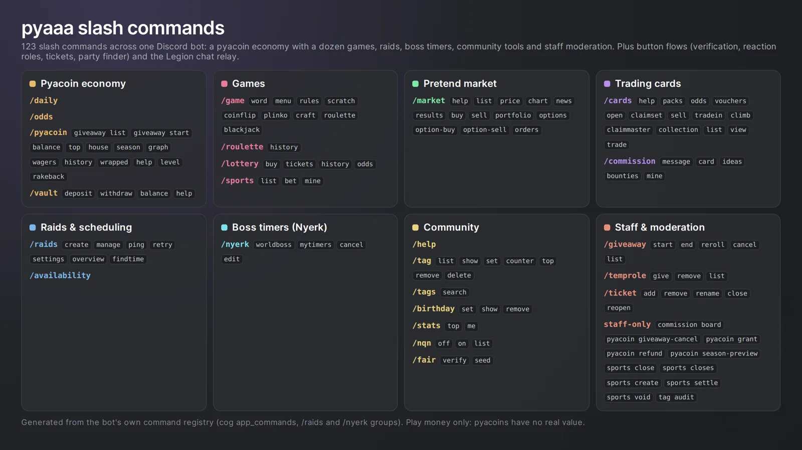
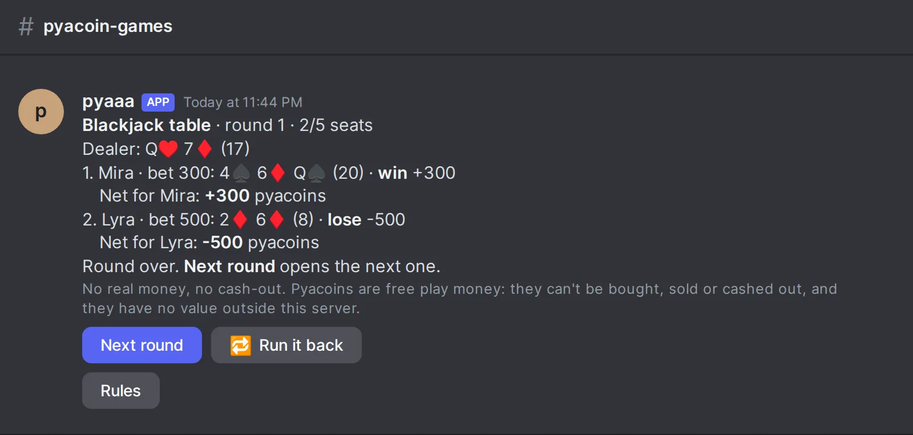
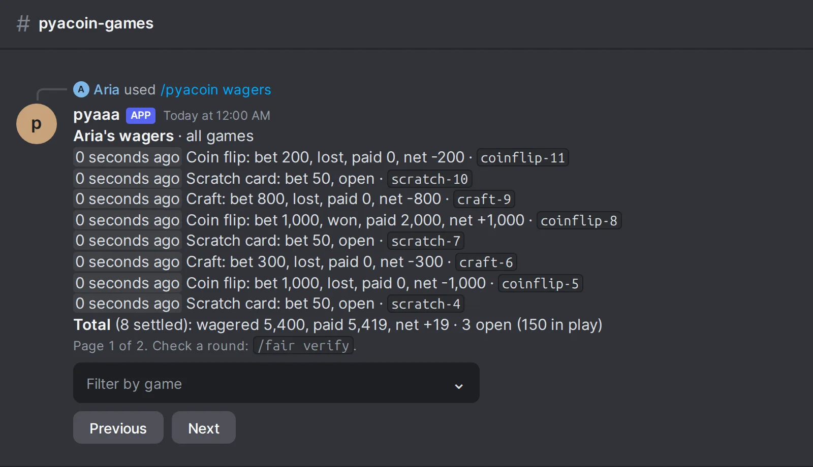
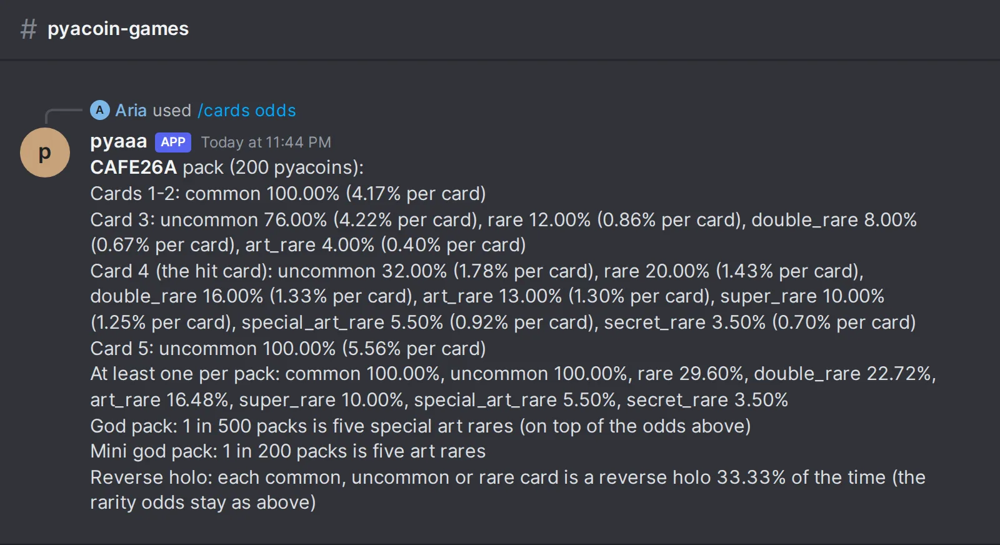
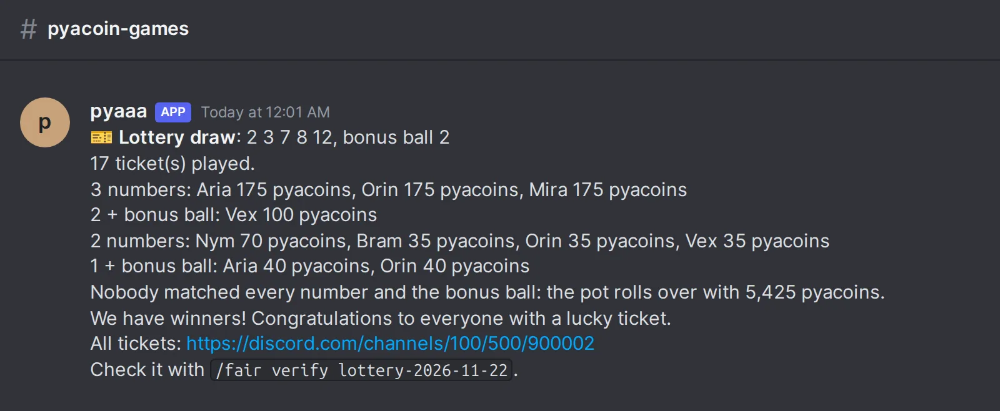
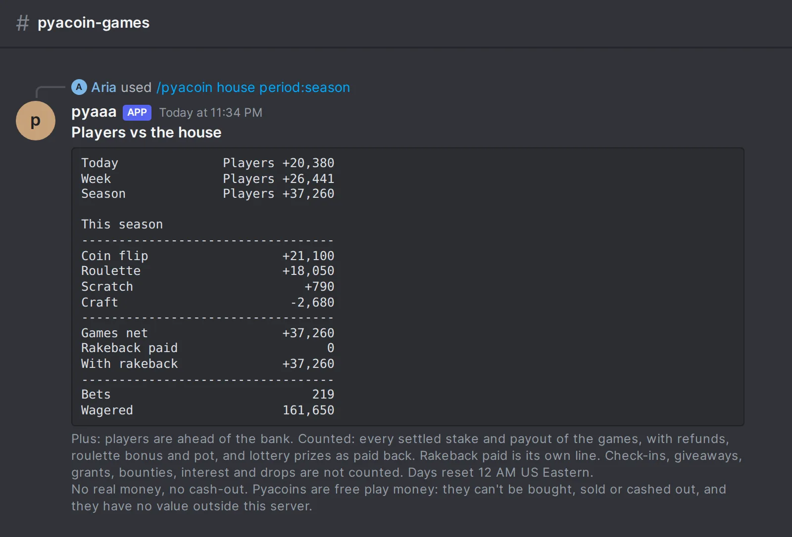
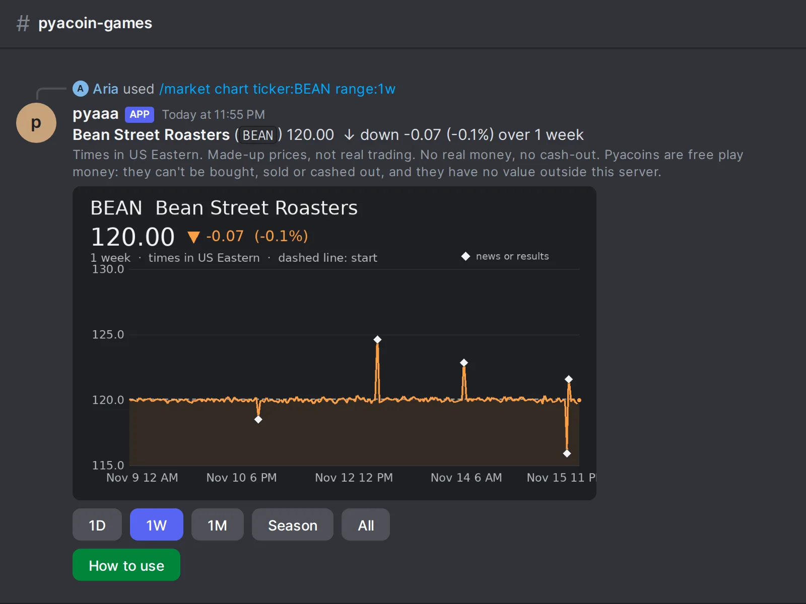

## The bot that runs the server also runs a casino

Most of this series has been about Nyerkulator, the desktop app, and the infrastructure behind it. This part is about the other big piece from [Part 1](/blog/2026/ai-agent-platform-part-1): **pyaaa**, the Discord bot that runs the community server itself.

On paper, pyaaa is a server management bot. It handles roles, verification tiers, channel access, raid signups, support tickets, boss timers (since the old Nyerk bot got folded into it), and a pile of smaller community tools. In practice, a huge share of what people actually *do* with it is gamble fake money. It runs a coin economy called pyacoins with about a dozen games, quarterly seasons with leaderboards and a Wrapped-style recap of your season, a trading card game, sports betting on staff-created events, and a pretend stock market full of made-up companies with simulated news, because once you have a currency, apparently a stock market is just what happens next.

All told, it's **123 slash commands in 8 categories**, generated straight from the bot's own command registry:

I want to be really clear about one thing before going any further, since this post is going to talk a lot about bets, payouts and odds: **pyacoins are play money.** They can't be bought, they can't be sold, they can't be cashed out, and they have no value anywhere outside our Discord server. You get them from daily check-ins, events and the games themselves. The bot says so right on the game messages, and it's not small print I'm hiding at the bottom of a terms page:

(Every Discord screenshot in this post comes from the bot's real code run offline against a throwaway database, with fake demo members like Aria, Mira and Lyra. Nobody from the actual server is in here.)

So if it's all fake money, why does any of this matter? Because the moment a bot is the house, people are going to wonder whether the house is cheating. That's a completely reasonable thing to wonder about a bot whose code you can't see, run by the same person who runs the server. "Trust me" is not an answer I wanted to give, so I asked for something better: every coin game had to be **provably fair**, with no blockchain and no outside randomness service. Players should be able to check any result themselves, after the fact, without having to trust me or the bot at all.

As with everything else in this series, the agents wrote the code. My job was deciding what "fair" had to mean, reviewing what came back, and approving it.

## How provably fair actually works

The approach is called commit-reveal, and it's simpler than it sounds. The whole trick is that the bot locks in its randomness *before* anyone bets and proves later that it didn't change it.

Here's the shape of it in pyaaa:

- **One server seed per game day.** At the start of the day, the bot picks a secret random seed and immediately publishes its SHA-256 hash. The hash is the commitment. It doesn't reveal the seed, but it pins it down: there's no practical way to find a different seed with the same hash.
- **The seed is revealed after the day ends.** Once nobody can bet against it anymore, the actual seed goes public, and anyone can hash it and check it matches what was published that morning.
- **Results come from HMAC-SHA256** over the client seed, the game, a round key and a nonce, keyed by the day's server seed. Same inputs, same output, every time. So once the seed is out, every round from that day can be recomputed from scratch.
- **Rejection sampling removes modulo bias.** This one is easy to get wrong. If you take a random number and just do `% 37` to pick a roulette pocket, some pockets come up very slightly more often than others, because the random range doesn't divide evenly by 37. Rejection sampling throws away the values from the uneven tail and draws again, so every outcome is exactly as likely as it should be.
- **Blackjack gets special handling.** A blackjack shoe gets shuffled once with that day's seed and then dealt over many hands, possibly past midnight. If the seed were revealed while that shoe was still in play, anyone could work out every card left in it. So a day stays sealed until the last shoe shuffled with its seed has finished being dealt.

Then there's the part players actually touch. Every result carries a round id, and **`/fair verify`** replays the real game code on that round's inputs and tells you whether the stored result matches. Your bet history shows those ids right next to each wager:

And because "the bot says the bot is fair" is a bit circular, there's also a short Python script, standard library only, no dependencies, that anyone can run on their own machine to check results without involving pyaaa at all. If you don't trust the verify command, you don't have to.

### What the review caught, and what it didn't

The fairness change went through an independent review before it merged, which is the written rule for changes in this project (Part 2 goes into the review and merge process). The big question for that review was whether a seed could leak before its reveal, since that's the one failure that breaks the whole scheme, and it found no way for that to happen.

It did find a real bug, though, and it's a good example of why the verify path deserves as much care as the game path. If a roulette spin's stored result had been changed, `/fair verify` reported it as "nothing stored" instead of "does not match." Those mean very different things. One says "I can't find this round," the other says "this round was tampered with," and a fairness checker that mumbles the second one as the first is not doing its job. That got fixed before merge.

The other thing I cared about: none of this was allowed to change the actual games. Odds and payouts had to come out exactly the same as before the change, and that was checked with the house-edge tests and Monte Carlo runs rather than eyeballed. Swapping out a random number generator is a great way to accidentally make roulette pay a little better or a little worse, and nobody would notice for weeks.

The same thinking about publishing the odds runs through the rest of the games. Trading card packs show their real pull odds, slot by slot, instead of hiding them behind a "rare chance!" label:

And the lottery draw itself tells you how to check it, right in the announcement:

## Keeping the books honest

Fair games are one half of it. The other half is making sure the coins themselves add up, because a currency that can silently appear or disappear isn't much of a currency, play money or not.

Every single coin change in pyaaa goes through an **append-only ledger**. Wins, losses, check-ins, grants, refunds, market trades, all of it. Nothing edits a balance directly and nothing deletes ledger rows. A balance is just what the ledger says it should be.

On top of that, there are two layers of checking:

- **Database triggers** in SQLite refuse any change that would leave a negative balance, and any row that disagrees with the balance it's supposed to produce. This is the "it physically can't happen" layer, sitting below the application code, so even a buggy feature can't write books that don't balance.
- **An hourly books check**, `econ_reconcile`, compares balances, holds (coins tied up in open bets) and transfers against the ledger, and flags anything that doesn't line up. This is the "if something slipped through, I'll hear about it within the hour" layer.

There's also a house view anyone can pull up, showing how players are doing against the bank by game, for today, the week and the season:

Having those checks is nice. Having them find real problems is where they earn their keep, and they found two.

### The test that only failed for an hour a day

The first one wasn't even a money bug, it was a clock bug, and it's my favorite kind of bug because it was so deeply weird.

The books check looks for "stuck" rounds, like a table round that's been open far longer than it should be. To decide what counts as stuck, it compared against a cutoff time, and that cutoff came from SQLite's built-in `now` instead of the project's own clock.

The result: tests failed, but **only between 12:05 and 13:00 UTC**. The rest of the day, everything passed. During that window, the test's fixture data for yesterday's round, viewed against the real wall-clock time, suddenly looked old enough to count as stuck. So the check flagged a perfectly healthy round. Outside that window, it didn't.

Tests that fail for one hour a day are miserable, because you rerun them and they pass and you start doubting your own eyes. The fix was making the cutoffs use the project's injectable clock, normalized to UTC, so there's exactly one idea of "now" in the whole system, and running the tests on a fixed clock so they can't drift with the real time. If you take one thing from this section: anything time-dependent that reads the real clock directly instead of a clock you can control will eventually bite you in a test, usually at a time of day you're not looking.

### The lottery prizes nobody got paid

The second one was a real money bug, and the books check is the reason it doesn't come back.

The weekly lottery has a pot for matching every number, plus fixed prizes for matching 2, 3 or 4 numbers. Before pyaaa PR #117, the weekly draw only ever paid out pot wins. The fixed prizes for partial matches were never paid at all. People with winning tickets just didn't get their coins.

Fixing the draw going forward was the easy part. Paying back everyone who'd been shorted needed more care, because the obvious approach, "run a script that pays people," is exactly how you accidentally pay people twice. Here's how it was done instead:

- **An owner-only audit page** works out, from each ticket's own draw, what that ticket should have won. Not from what someone remembers, not from a spreadsheet, from the actual ticket and the actual draw it was in.
- **Dry run first.** The page shows every shortfall it would pay and the total, without touching anything. I look at it.
- **Then Apply.** Each shortfall gets paid exactly once, written to the ledger with the reason `lottery_backpay` and an idempotent reference per ticket. If Apply gets clicked twice, or the page gets reloaded mid-run, the second attempt sees the reference already exists and does nothing.
- **The books check now looks for it too.** Any winning ticket without a matching payout gets flagged, so this specific class of bug can't quietly happen again.

"Dry run, then apply, idempotent by design" is the same pattern I'd use for any bulk change on a real system, and it was nice to see it carry over cleanly to something as silly as fake lottery coins. Quick fixes often become permanent ones, and a backpay that might double-pay is a quick fix that creates its own cleanup job.

## A bonus bug: logging inside a transaction

This one isn't economy code, but it's pyaaa-family code and too good a lesson to skip.

Nyerkulator can read world boss timers straight from the game and forward them through the server to the Nyerk bot, which posts them in Discord. At some point those forwarded timers started timing out. The bot's API was hanging for about **15 seconds**, and the server gives up after **10**, so every forward failed.

The cause: the bot was writing a log entry **inside the database transaction** that saved the timers. Whatever that log write was doing, the whole save sat waiting on it, long enough to blow straight past the server's timeout. The fix was simply moving the log write to after the timers are saved, outside the transaction.

The general rule I took away from it: keep transactions as short as possible and keep anything that isn't the actual data change (logging, network calls, notifications) out of them. A transaction should be the smallest unit of "this must all happen together," not a convenient place to put everything related to a request.

## The market, briefly

I'd be lying if I said the fake stock market wasn't the most fun thing in the bot. It has made-up companies, an index fund, simulated company news and results that move prices, options trading for the brave, and price charts with range buttons:

The same rules apply to it as everywhere else in the economy: every buy and sell is a coin change, so it goes through the ledger, and the chart says right on it that these are made-up prices and not real trading.

## Why the tests matter more here than anywhere

Economy code is the part of pyaaa where a bug costs people something they care about, even if that something is imaginary. A payout that's off by a bit, a prize that never gets paid, a refund that runs twice: none of that is visible in a quick manual test, and all of it adds up.

That's part of why pyaaa's test suite is as big as it is. The pre-merge check currently runs **4,539 tests**, plus a lint pass, a scan for anything that shouldn't be public, and gitleaks over the full history, and it has to pass on a PR's exact final commit before that PR can merge. Across the merged PR history, **95% of pyaaa pull requests changed tests**. When agents are writing the code, the tests are a big part of how I know what they wrote actually does what I asked, and for the economy especially, "the odds didn't change" is something I want proven by a test, not promised in a PR description.

## Wrapping up

None of the fairness machinery here is new. Commit-reveal and HMAC-derived results are well-established, and append-only ledgers with reconciliation are how real accounting systems work. What I liked about doing it here was applying the same standards I'd want on a real system to something that's ostensibly just for fun: publish your commitments, prove your results, never edit history, check the books on a schedule, and make every bulk fix a dry run first. It turns out a Discord full of people betting fake coins on blackjack is a surprisingly good motivator for getting that right.

As with the rest of the platform, the pyaaa repo is private and still in active development, so there's no code to link, but the numbers and examples here come from its docs, PR reviews and test runs.

That's the end of the series for now. If you skipped ahead, [Part 1](/blog/2026/ai-agent-platform-part-1) covers what the platform is and how the agent team works, and the parts in between go into the merge queue, production access, the passive game reading, minimap tracking and the performance work.
