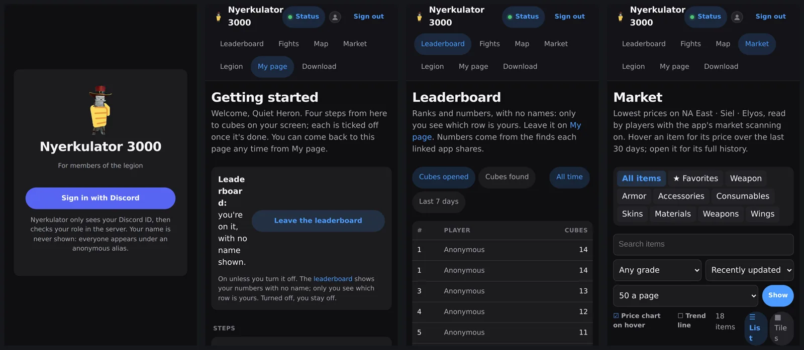

Seven parts in, and I've talked a lot about merge queues, passkeys, packet decoders and golden tests. What I haven't really done is show what a member of the legion actually sees when they use this thing. Which is a little backwards, because none of the plumbing matters if the person on the other end can't figure out how to install it, doesn't trust what it sends, or opens the website and has no idea what they're looking at.

So this part is the tour. Signing in, installing the app, the overlays drawn over the game, and the members website, in roughly the order a new member runs into them. If you're new here, [Part 1](/blog/2026/ai-agent-platform-part-1) covers what the platform is and how it gets built.

A theme you'll notice: a lot of the user-facing design is about what the platform *doesn't* keep. That wasn't an afterthought. When you're asking people in a gaming community to run an app that watches their game traffic and reads their screen, the first question is always "what does it do with my stuff," and the honest answer had better be short.

## A quick note on the screenshots

Everything in this post is real output, but none of it is a live member's data, and I want to be upfront about how it was made:

- **Website pages** were captured against throwaway databases full of made-up members (Aria, Kael, Mira and friends), on a desktop-sized and a phone-sized browser.
- **Most app pages** come from the app replaying a recorded game session, either my own recording or a synthetic demo session, with the app's built-in screenshot mode. A replay never contacts the server, which is why some quest, pet and mob names show up as placeholders: those names normally come from the server's catalog.
- **The DPS meter pages** come from a headless render of a made-up sample fight against a "Practice Golem," so no real party names show up anywhere.
- **Anything labeled composite** is the real app window drawn over a still or a recording of the game, and the captions say so.

## Step one: signing in without giving up your name

Everything starts with Discord sign-in, because membership in the legion's Discord server is what decides whether you get in at all.

That little paragraph under the button is the whole privacy model in three lines. The site gets your Discord user ID and checks that you have the right role in the server. That's it. The website's privacy page spells out the rest: your Discord name and avatar are never stored or used, and your messages, servers and email are never requested in the first place. Once you're in, you're shown everywhere under an anonymous alias. In the demo data that's "Quiet Heron," which, honestly, is a better gamer tag than most people pick for themselves.

The site works on phones too, which matters more than you'd think for a gaming community, because a lot of "did my cube count?" checking happens from a phone while the PC is busy running the game.

If you look closely at the second phone, the "Leaderboard:" label wraps one letter-chunk at a time. The phone layout still has a rough edge or two, and that's one of them.

## Step two: getting the app running

After signing in, a new member lands on a Getting started page with four steps that tick themselves off as you complete them, from downloading the app to sharing your first cube finds.

{{< carousel images="{site-welcome.webp,site-home.webp,site-app-signed-in.webp}" captions="{site-welcome.webp:Getting started with four steps that tick themselves off from download to sharing cube finds,site-home.webp:The signed-in home page with your anonymous alias and shortcuts to the leaderboard and My page and the download,site-app-signed-in.webp:Signing in from the app opens a browser tab that hands control back to the desktop app}" aspectRatio="16-9" interval="6000" >}}

The steps are pretty practical. The download page has the app, its archive password and the short list of things to install first: Windows 10 or 11, Npcap (the packet capture driver the app relies on), and 7-Zip or NanaZip to open the archive. Download links on that page are one-time links, and I'm skipping the screenshot of it here because it shows a password, even a dummy one. Then you start the app, and it shows you two things before anything else: what it shares, and a setup guide. Signing in from the app's Home page opens your browser, you sign in with Discord, and the tab tells you that you can close it and go back to the app. After that, the app checks your access by itself every day.

The setup guide is the page I'd point to if someone asked what "good onboarding" means for a tool like this. Instead of a wall of instructions, it checks each step for you and shows a tick when it's done.

{{< carousel images="{app-setup-guide.webp,app-what-is-shared.webp,app-settings.webp,app-status-logs.webp}" captions="{app-setup-guide.webp:The first-start setup guide checks each step for you and ticks it off,app-what-is-shared.webp:What Nyerkulator shares in plain language with every sharing switch on one page,app-settings.webp:One searchable Settings page for the app and every tool,app-status-logs.webp:Status and logs shows capture health and each tool's state and lets you export a log}" aspectRatio="3-4" interval="6000" >}}

A few things it walks through:

- **Is Npcap installed?** Checked automatically.
- **Is the game running and are you in the world?** It says to load all the way into the world, not the character screen, and that a dot in each tool's header turns green within a few seconds. It also calls out VPNs and ping reducers like ExitLag or Mudfish, which need Npcap's loopback support to work with the app.
- **The window.** Home lists the tools, and each one can be switched on or off. Ctrl+Shift+F9 makes the window click-through so your clicks go to the game, and Ctrl+Shift+F10 hides it.
- **Per-tool setup.** For Radar, you pick your faction, Elyos or Asmodian, so routes stay away from the other side's guarded teleports. There's also an option to bring the game to the front when a cube appears while you're in another window. It's off unless you turn it on, because an app yanking focus without asking is a great way to get uninstalled.

## What the app shares, in plain language

This is the page I'm happiest exists. Every bit of sharing the app does is listed on one page, in normal sentences, with the switch for it right underneath.

Some highlights, straight from that page:

- **Cube finds and live sightings** are shared anonymously and are on by default, because more shared finds help everyone find cubes faster. One click turns it off, and the page says plainly that Radar works fully without it. There's even a "Preview my upload" button so you can see exactly what would be sent.
- **Live sightings are short-lived.** Cubes you can see right now are kept in the server's memory for 15 minutes and never stored. Resource nodes are kept for up to 10 minutes.
- **Spawn points for routing** carry no names, characters or entity IDs. The server keeps only a one-way code of your install ID, used to count how many apps saw a point, and only shows a point to others once two different apps have seen it.
- **Trace progress** is tied to a code made on your PC from your character's name and game server, never the name itself. Only you can see it, on your own page on the website, and you can delete it there.
- **Boss timers for the Nyerk bot** send the boss, whether it's alive, and the time. Your position is never sent.

There's one more privacy detail that doesn't show up on that page but matters just as much. When someone uploads logs for a bug report, the app masks their Windows user name and computer name as `<home>` and `<pc>` before anything leaves the PC. That fix came after uploaded logs turned out to carry both.

## In the game

Then there's the part people actually installed it for. The headline is still Radar, with its map and the 3D arrow drawn over the game pointing at the nearest Hidden Cube.

That one's a composite: the app ran live and Windows drew its real windows on top of a full-screen still of the game. The rest of the in-game tools follow the same idea. Read what the game already tells you, then draw something useful on top.

{{< carousel images="{overlay-pointer-closeup.webp,overlay-pointer-preview.webp,overlay-tile-round.webp,overlay-dps-meter.webp}" captions="{overlay-pointer-closeup.webp:Composite close-up of the screen pointer with distance and height to the cube,overlay-pointer-preview.webp:The same pointer as previewed inside the app window,overlay-tile-round.webp:The Not This Tile event in the game with player names blurred,overlay-dps-meter.webp:Composite of the DPS meter over the game using a made-up sample fight}" aspectRatio="16-9" interval="6000" >}}

- **The screen pointer** is a 3D arrow toward the cube, with the distance and height written under it, something like "50 m, 5 m up." Once you're within a few meters it turns into a ring.
- **The tile puzzle helper** is for an event called "Not This Tile?", where the floor is a grid and only some squares are safe. The helper reads the safe-square pattern from the game's own traffic and marks it back on the floor for you, turning with your camera.
- **The DPS meter** sits over the game and shows damage, DPS, share, how much of the fight it saw, and combat power per party member, colored by class.

Inside the app, each of those tools has its own page:

{{< carousel images="{app-nyerk-timers.webp,app-cube-notebook.webp,app-tile-helper.webp}" captions="{app-nyerk-timers.webp:Nyerk shows world and Abyss and field boss timers read from the game plus the Dimensional Invasion state,app-cube-notebook.webp:The cube notebook keeps confirmed and candidate spots with export and import and merge,app-tile-helper.webp:The tile puzzle helper with its overlay options}" aspectRatio="3-4" interval="6000" >}}

And the combat side gets a surprising amount of customization, because apparently everyone has opinions about how a DPS meter should look:

{{< carousel images="{meter-all-columns.webp,meter-player-colours.webp,meter-fight-detail.webp,meter-settings.webp}" captions="{meter-all-columns.webp:The meter with every column on and a gradient fill,meter-player-colours.webp:The meter colored per player with large bars,meter-fight-detail.webp:Fight detail with contribution and crit and back and perfect rates plus buff uptime and a per-skill table,meter-settings.webp:Meter settings with a live preview and column order and class colors}" aspectRatio="16-9" interval="6000" >}}

## The members website: your own page

Back on the website, every member gets a My page. It's built around the idea that your data is yours to see and yours to switch off.

{{< carousel images="{site-my-page.webp,site-my-page-traces.webp,site-my-page-progress.webp,site-my-page-fights.webp,site-my-page-apps.webp}" captions="{site-my-page.webp:My page overview with the leaderboard opt-out and your own cube numbers,site-my-page-traces.webp:Empyrean Traces progress per character on the game maps,site-my-page-progress.webp:Progress shows achievements and skins and pets per character,site-my-page-fights.webp:Your boss fights and DPS with sharing controls,site-my-page-apps.webp:Linked apps and settings backups and signed-in browsers}" aspectRatio="16-9" interval="6000" >}}

The tabs, roughly:

- **Overview.** Your cube numbers, and the leaderboard switch. You're on the leaderboard unless you turn it off, but the leaderboard never shows your name either way. Turned off, you just stay off.
- **Empyrean Traces and Progress.** Per-character progress: traces on the game maps, plus achievements, skins and the pet collection.
- **Fights.** Your boss fights and DPS. By default, signed-in members can see your characters' names and classes on the fights you were in, in the rankings and in gear history, and there's a single button to hide your fights and characters.
- **Apps.** This one's my favorite for how much it explains. Signing in from the app links it to your account automatically, and older app versions can link with a short code that lasts 10 minutes. You can unlink any app. There's a settings backup the app can keep on your account, which deliberately leaves out your install ID, sign-in, tokens and window positions, keeps the newest copy until you delete it and keeps up to nine earlier ones for 30 days. And there's a list of signed-in browsers: each stays signed in for 7 days after you last used it, 30 days at most, and leaving the Discord server or losing the access role normally ends all of them within minutes.

## The members website: what everyone shares

The rest of the site is where all those anonymous little uploads from members' apps turn into something useful for everyone.

{{< carousel images="{site-leaderboard.webp,site-map.webp,site-fights-rankings.webp,site-gear-history.webp,site-market.webp,site-market-item.webp,site-bar-images.webp}" captions="{site-leaderboard.webp:The anonymous leaderboard where only your own row is named,site-map.webp:The community cube map with cube spots and teleports and gathering nodes from shared app data,site-fights-rankings.webp:Boss-kill rankings with the best DPS per character and class,site-gear-history.webp:Gear history plots item level and combat power against DPS over time,site-market.webp:Lowest market prices scanned by members' apps with hover price charts,site-market-item.webp:One market item with its lowest price and listings history,site-bar-images.webp:Members upload custom DPS meter banners that go live at once}" aspectRatio="16-9" interval="6000" >}}

- **The leaderboard** is ranks and numbers with no names. Every row says Anonymous except your own, which is highlighted with your alias and a little "you" tag. Only you can see which row is yours.
- **The community map** shows every Hidden Cube spot the community has confirmed, the candidate spots nobody has confirmed yet, teleports, and resource nodes. A node someone saw in the last 10 minutes shows up larger and ringed, and one gathered in the last 5 is faded, so you can tell what's probably still up. The map art and node positions are credited to questlog.gg right on the page.
- **Fight rankings and gear history** turn shared fights into the best DPS per character and class, and plot a character's item level and combat power against their DPS over time.
- **The market viewer** shows the lowest prices members' apps have scanned while they scroll the in-game market, with a price chart on hover and a full price history for each item.
- **Bar images** let members upload a custom banner for their DPS meter bar. Uploads go live right away and get reviewed by an owner afterwards. There are limits on size and frames, and every image is re-saved by the server so its metadata gets dropped. Nobody needs GPS coordinates from a phone photo attached to their DPS bar.

## The pages that keep it honest

Finally, three pages that don't get much traffic but say a lot about how the platform treats its members.

{{< carousel images="{site-status.webp,site-privacy.webp,site-testing-guide.webp}" captions="{site-status.webp:A public status page with uptime over 24 hours and 90 days from inside and through Cloudflare,site-privacy.webp:The privacy page lists exactly what is kept and for how long and how to delete it,site-testing-guide.webp:The testing guide covers beta builds and good bug reports and recording and dev mode}" aspectRatio="16-9" interval="6000" >}}

- **The status page** shows whether the server is up, with uptime over the last 24 hours, 7, 30 and 90 days, measured both from inside and through Cloudflare. If something's down, members can see it for themselves instead of asking in Discord.
- **The privacy page** lists exactly what the site keeps, for how long, and how to delete it. It's the same information as the app's sharing page, from the website's side.
- **The testing guide** is for beta testers. It explains how to switch to the Beta release channel, how betas are named, and what a good bug report looks like: the log code, a screen recording, what you did and when, and your setup. User reports like that are what drove the minimap fixes in [Part 5](/blog/2026/ai-agent-platform-part-5).

## What I took away from building the user side

A few things stood out once I stepped back and looked at the platform as a member instead of as the person approving the merges:

- **Privacy is a feature you can see.** The anonymous alias, the "Leave the leaderboard" button, the "Preview my upload" button and the line saying Radar works fine without sharing are all small. Together, they're the difference between "trust me" and "here's exactly what happens, check it yourself."
- **Defaults carry most of the weight.** Sharing is on by default because the whole community benefits, but every default comes with a visible switch and a plain explanation of what it does. Nothing that changes your experience, like pulling the game to the front, is on unless you turn it on.
- **Onboarding is a checklist, not a manual.** A setup guide that checks Npcap and the game connection for you saves more support questions than any FAQ.
- **The website explains itself.** Almost every page has a sentence or two under its title saying what it shows and where the data came from. That's not decoration, it's how a member knows the map is built from other members' apps and the leaderboard can't see their name.

The Discord side of the platform, where the server runs itself, gets its own posts next: [Part 9](/blog/2026/ai-agent-platform-part-9) covers server management and the legion tools, and [Part 10](/blog/2026/ai-agent-platform-part-10) covers raids, boss timers and the party finder.
