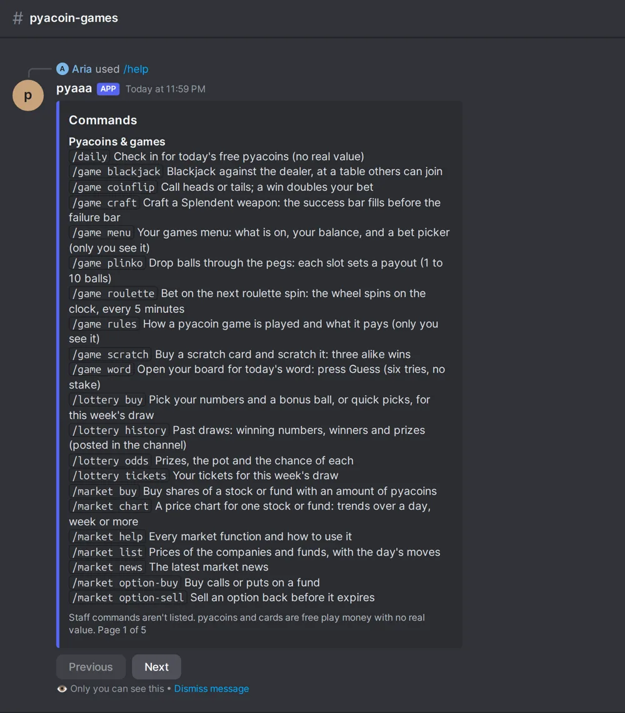

[Part 7](/blog/2026/ai-agent-platform-part-7) was the fun half of pyaaa: coin flips, blackjack tables, a pretend stock market, and a lot of math to prove none of it was rigged. This part is the other half, the half nobody screenshots for Twitter. pyaaa is also the bot that runs the community's Discord server. Roles, permissions, verification, tickets, giveaways, logs, the legion roster, and the relay that copies our in-game legion chat into Discord all go through it.

If you've read [Part 3](/blog/2026/ai-agent-platform-part-3), the theme here will sound familiar. On the hosts, the rule is that agents can look and propose, but anything that changes a host waits for my passkey. pyaaa takes the same idea and applies it to a Discord server. A Discord server's role list and permission overwrites are basically a config file that anyone with the right role can edit by right-clicking, and I wanted that to be a lot less exciting than it usually is.

## The portal

pyaaa has a web portal next to the bot. You sign in with Discord, and only allowlisted accounts get in. The home page is laid out like a control panel: a search box, every page grouped by area (server, community features, games, owner tools), anything waiting for approval, a row of common tasks, and a little "at a glance" block with the latest backup, role and channel counts, locked channels, and today's alerts. It also shows the riskiest settings found in the latest backup, right there on the front page, which is exactly where I want to see "2 roles grant Administrator, 1 not expected."

The page I like most is "What can I do here?" Every task on it explains what it does, asks for what it needs, and shows a preview before anything changes. Tasks that aren't built yet are grayed out with the roadmap phase they're planned for, so the portal doubles as a to-do list.

The Features page is where you can see how much this bot replaced. Every community feature has its own switch and settings, everything is off until someone switches it on, and several of them carry a little note saying which bot they took over from: Carl-bot for reaction roles, ServerStats for counter channels, Statbot for activity stats, Ticket Tool for tickets, GiveawayBot for giveaways. Fewer bots in the server means fewer things with permissions, fewer dashboards, and fewer places for something to quietly break. The activity stats are counts only, by the way. Who, where, when, and how long, never message text.

{{< carousel images="{portal-login.webp,portal-home.webp,portal-do.webp,portal-server.webp,portal-features.webp,portal-feature-tickets.webp,portal-stats.webp}" captions="{portal-login.webp:Portal sign-in with Discord for allowlisted accounts only,portal-home.webp:Portal home with everything grouped and the approval waiting at the top,portal-do.webp:What can I do here. Every task explained with a preview before anything changes,portal-server.webp:Server hub with a live status on every feature tile,portal-features.webp:Every module has its own switch and says which bot it replaced,portal-feature-tickets.webp:Settings page for one feature module,portal-stats.webp:Activity stats for members and messages and voice. Counts only}" aspectRatio="16-9" interval="6000" >}}

*All portal screenshots use a demo server called "Cafe Demo" with made-up members (Aria, Kael, Mira, and friends). Discord-style IDs are blurred.*

## Every change is a job

Here's the core rule, straight from the portal's own Rules page: every change pyaaa makes in Discord is a **job**, a list of changes you can read, with a backup taken before the first change and after the last.

The Rules page then spells out what runs on its own and what waits. Auto-approval is currently **off**, so every job waits for me on the Jobs page. Even with auto-approval on, some things always wait:

- every job an agent planned, whatever it does,
- anything that touches a locked role: editing, deleting, moving it, changing who has it, or its channel permissions,
- anything that changes a locked channel,
- any role gaining a strong permission like Kick Members, Ban Members, Administrator, Manage Server, or Manage Roles,
- any job whose plan has errors.

And then there's an "Always" list, which reads like the house rules for the bot itself. pyaaa never messages members. Only pyaaa should have Administrator, and anything else that does shows up as a finding. pyaaa never moves or edits the break-glass role or its own role. New roles get a place in the role order. Drift gets reported and a fix gets planned.

That first bullet, "every job an agent planned," is the whole series in one line. The agents that work on pyaaa can plan a change to the live server all day long. They can't make it happen. In the Jobs screenshot below there's a job sitting in "Waiting for you": move Staff above Moderator, one change, touches locked role Staff. That's exactly the kind of thing that should need a human.

The backups are the other half of this. Every snapshot (scheduled, manual, or job) is kept for good, and any two can be compared, so "what changed between Tuesday and now" is a table instead of an argument. Each snapshot also gets an audit report: findings sorted by severity, a role-by-permission matrix that shows only the elevated permissions as columns, and a Restore section that builds a plan to put the server back the way the snapshot has it. Nothing is deleted and nothing runs until the plan is approved. A restore is just another job.

Two more pages close the loop. Owner tools is where the admin commands that used to need SSH now live: feature switches, importing Carl-bot's log layouts and birthdays, scanning old reaction-role channels, and cleaning out references to models the server no longer has. Each one shows counts and masked output, never a member, the ones that change anything start with a dry run, and every run becomes one row in the portal activity log. That log records every login and every action taken through the portal. If something changed, there's a row for it.

{{< carousel images="{portal-rules.webp,portal-jobs.webp,portal-snapshots.webp,portal-diff.webp,portal-audit-report.webp,portal-owner-tools.webp,portal-activity.webp}" captions="{portal-rules.webp:The Rules page. What runs by itself and what waits for approval,portal-jobs.webp:Change jobs with one held for approval because it touches a locked role,portal-snapshots.webp:Every server backup is kept for good with a diff against live,portal-diff.webp:A backup diff showing exactly what changed between two snapshots,portal-audit-report.webp:Permission audit with findings and a role by permission matrix,portal-owner-tools.webp:Owner tools that used to need SSH. Counts and masked output only,portal-activity.webp:Every portal login and action is recorded}" aspectRatio="16-9" interval="6000" >}}

## Watching for drift

Not every change comes through pyaaa. People with the right roles can still click around in Discord directly, and other bots can make changes too. So pyaaa watches for **drift**: changes made outside it. The Alerts page in the demo has the typical ones, a new webhook created in the announcements channel and a moderator role that gained Manage Channels, next to routine entries like a finished job and the daily backup.

Some channels are important enough that drift isn't just reported, it's undone. A **locked channel** has its name, topic, category, and permission overwrites stored as a baseline. Any change made in Discord is reverted immediately and reported as a sensitive alert. That sounds simple, and it mostly is, except for one case that bit us. Another bot deleted a role, which left pyaaa reverting a locked channel over and over. The first fix decided a channel was "stuck" based on later gateway events, and the independent review before merge caught that a member repeating the same change could use that to make pyaaa stop enforcing the lock entirely, which it rated HIGH. The fix that went in only trusts Discord's own answer to pyaaa's own edit, prunes overwrites for deleted roles, and puts a per-channel lock around enforcing and pruning. The Locked channels page now says it plainly: a deleted role's overwrites leave the baseline on their own, and a revert Discord doesn't take is tried once, then reported at most once a day.

Two archive pages round this out. Discord only keeps audit log entries for 45 days, so pyaaa copies them into its own audit log archive permanently, with filters and a JSON export. And the logs archive can keep pyaaa's own copy of every message in the server's logs channel. That page opens with a warning box, because that channel holds members' deleted and edited messages. The warning explains where the data lives, that deleting it here clears the live database at once, and that the standby's backup history keeps what was deleted until the replication retention runs out. If you're going to keep something sensitive, the least you can do is say exactly where it goes.

{{< carousel images="{portal-alerts.webp,portal-locked-channels.webp,portal-audit-log.webp,portal-logs-archive.webp}" captions="{portal-alerts.webp:Drift alerts for changes made outside pyaaa,portal-locked-channels.webp:Locked channels. Any edit in Discord is reverted and reported,portal-audit-log.webp:Discord keeps audit logs for 45 days and pyaaa keeps them for good,portal-logs-archive.webp:The logs archive warns up front that it holds members' data}" aspectRatio="16-9" interval="6000" >}}

## The community features

The everyday stuff members actually touch lives in Discord, with the setup in the portal.

**Verification** happens in a verify channel. A new member answers a few questions; a wrong answer gets a hint and is cleaned up, and a right one is acknowledged. On the staff side, moderators get pinged with the answers and the roles approval will give, and approving is a reaction.

**Reaction roles** are the classic "react to get a role" menus, with Normal mode (hold as many as you like) and Unique mode (one per message). The portal's how-it-works list is mostly about what it will never do: staff, locked, and verification roles, timed roles, roles at or above pyaaa, bot roles, and roles with strong permissions are never given or taken this way, and nobody is messaged.

**Timed roles** give someone a role for a while, like Giveaway Host for a day. pyaaa checks every 60 seconds and keeps them in its database, so a restart doesn't make anyone keep a role forever. Staff use `/temprole` in Discord, and owners can give them from the portal.

**Tickets** are a button that opens a private channel with staff, with Claim and Close. Transcripts, including attachments, are saved on our own host and shown only to signed-in owners. There's also an importer for the old Ticket Tool transcripts, which runs as a dry run first.

**Tags** are `!name` commands that answer with one of several random responses and never ping anyone. **Giveaways** are started with `/giveaway start` and can have a role requirement, and winners are drawn at random from the entrants still in the server.

And then there's the **server log**: member joins, message edits and deletes with before and after, and role changes batched together. And **/help**, which is generated from the bot's own command registry and only lists what that member can use right now, paged.

{{< carousel images="{portal-reaction-roles.webp,portal-timed-roles.webp,portal-tickets.webp,portal-tags.webp,portal-giveaways.webp}" captions="{portal-reaction-roles.webp:Reaction roles with Normal and Unique modes,portal-timed-roles.webp:Timed roles that pyaaa removes when time is up,portal-tickets.webp:Tickets panel and Ticket Tool transcript import with a dry run,portal-tags.webp:Tag commands with random answers that never ping,portal-giveaways.webp:Giveaways drawn from entrants still in the server}" aspectRatio="16-9" interval="6000" >}}

{{< carousel images="{discord-verify-member.webp,discord-verify-staff.webp,discord-reaction-roles.webp,discord-timed-roles.webp}" captions="{discord-verify-member.webp:Verification. A wrong answer gets a hint and a right one is acknowledged,discord-verify-staff.webp:Staff get the answers and approve with a reaction,discord-reaction-roles.webp:React on a role menu to pick your pings,discord-timed-roles.webp:Staff give a timed role and pyaaa removes it at expiry}" aspectRatio="16-9" interval="6000" >}}

{{< carousel images="{discord-tickets.webp,discord-giveaway.webp,discord-server-log.webp}" captions="{discord-tickets.webp:Support ticket panel and the private channel with Close and Claim,discord-giveaway.webp:Staff giveaway with a role requirement and the winner,discord-server-log.webp:Server log with joins and edits and deletes and role changes}" aspectRatio="4-3" interval="6000" >}}

*The Discord images are the bots' real output rendered offline with fake members, no Discord connection, and no tokens. Verification, timed roles, and reaction roles were composed by hand from the code's own strings rather than run end to end.*

## The legion side

A good chunk of the community is one in-game legion (Aion's version of a guild), and the website has a whole Legion section for it.

**Legion in numbers** is the public-to-members view: class and role mix, ranks, item level by class, a histogram of item levels, and joins per week. Only totals, nobody's name or account. **The roster** is the officer tool: drag to reorder, alts under their mains, filters and columns, and an edit page per character with game details, Discord details, and notes. **Private numbers** is for officers and roster editors only: how many players are on Discord, statuses, alts, and who hasn't been online.

Then there are two pages that are mostly just fun. **Connections** draws the legion as a network: each player is a circle, alts are folded into their main, and arrows point to whoever they're associated with, with the legion itself in the middle. **Legacy** puts members on a timeline across the games and groups the community has been through before, so you can see who came over from where.

The roster isn't just a spreadsheet, either, because pyaaa reads it. **Legion warm-up** gives new legion members the Discord access role a random 13 to 15 days after their join date on the roster. Each person's delay is rolled once and kept. Removed members lose the role, retired members keep it, every grant and removal is posted as an alert, and members are never messaged. From the portal, access can also be granted early or the wait extended. It's a small feature, but it's a nice example of the pieces talking to each other: the website owns the roster, the bot owns Discord, and neither one reaches into the other's data.

{{< carousel images="{legion-numbers.webp,legion-roster.webp,legion-private-numbers.webp,legion-connections.webp,legion-legacy.webp,legion-roster-edit.webp,legion-roster-add.webp,legion-warmup.webp,legion-chat-admin.webp}" captions="{legion-numbers.webp:Legion in numbers. Totals only and nobody's name,legion-roster.webp:Roster editor with alts under mains,legion-private-numbers.webp:Private numbers for officers only,legion-connections.webp:The legion drawn as a network of players and communities,legion-legacy.webp:Members across past games on one timeline,legion-roster-edit.webp:Editing one roster character,legion-roster-add.webp:Adding a character to the roster,legion-warmup.webp:Legion warm-up gives access after a 13 to 15 day wait,legion-chat-admin.webp:Chat relay admin with reader health and unknown characters}" aspectRatio="16-9" interval="6000" >}}

## The legion chat relay

The last piece is the one people actually notice day to day. The desktop app reads the game's legion chat off the screen (how it does that, and how it got 14 times faster, is in [Part 5](/blog/2026/ai-agent-platform-part-5) and [Part 6](/blog/2026/ai-agent-platform-part-6)) and the server posts it into a Discord channel, live, under each character's name and picture. Character names in the chat ping the linked Discord member, unless they're on do-not-disturb, in which case the name is just bold.

Two more channels hang off the same reader. A **doorbell** channel gets the game's "applied to join" and "joined the Legion" notices in their own channel. And **system notices** say when the relay starts, when it stops, and when the game is in maintenance, with the announced end time.

On the admin side there's a page for the readers themselves: each feeder over the last week, with counts for messages that were never read, covered by something, too old, or refused, plus times the reader lost its place. Below that is where characters the bot couldn't read get named once, so the bots read them correctly from then on and posts that showed them get corrected.

{{< carousel images="{discord-legion-relay.webp,discord-legion-doorbell.webp,discord-relay-notices.webp}" captions="{discord-legion-relay.webp:Legion chat posted live under each character's name,discord-legion-doorbell.webp:The doorbell posts join applications and new members,discord-relay-notices.webp:System notices for maintenance and start and stop}" aspectRatio="16-9" interval="6000" >}}

*The relay images were composed by hand from the server's own message strings, with made-up character names.*

## What I took from this one

None of these features is new on its own. Every Discord server of a certain size ends up with reaction roles, tickets, a log channel, and a verification step, usually from four different bots. What's different here is how changes are handled: one bot, one portal, a written list of what runs on its own and what waits, a backup on both sides of every change, and a log of everything.

It's the same lesson as the host gate in Part 3. Rules in a prompt only go so far. When agents (or people) can change something that matters, the rule needs to be built into the system so that their changes simply can't skip the approval step. "Every job an agent planned waits for you" is one line on a settings page, and it's the reason I'm comfortable letting agents work on the bot that runs a live community server.

Next up, in [Part 10](/blog/2026/ai-agent-platform-part-10): raids, boss timers, and the party finder, the features that exist mostly so people stop asking "when does it spawn?" in general chat.
