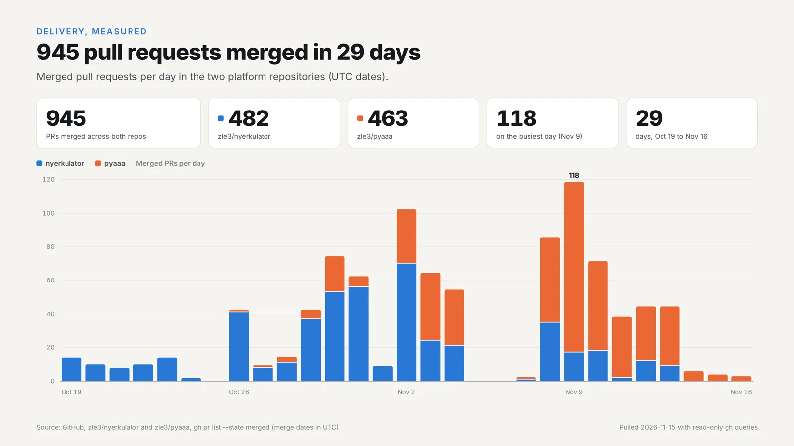

## It started as a radar for one thing

Aion 2 has these things called Hidden Cubes. They spawn at one of a set of possible spots on the map, and the game doesn't exactly announce where. Naturally, a Discord full of people playing the same game wanted to know where the cubes were the moment they showed up, instead of running a loop of every candidate spot and hoping.

So on October 15th I put out **Cube Radar**, a small Windows app that did exactly one thing: tell you a Hidden Cube just spawned, and where. It had its own little community server so people could share confirmed spots, and that was supposed to be the whole project.

It was not the whole project.

Four days later, Cube Radar had gone from version 0.3 to 0.7.5 and picked up a route planner, minimap camera reading, a 3D arrow drawn on top of the game pointing at the cube, signed update checks, and a website with Discord sign-in. A month after that, it had turned into this:

- **Nyerkulator 3000**, a Windows desktop companion app with a home page of tools: Radar (the old Cube Radar), Duty quests, Pets, Market prices, a tile puzzle helper, world boss timers, a DPS meter, and a relay that copies our legion's in-game chat into Discord.
- **A website and server**: a members-only site, a personal page for each member, an anonymous leaderboard, a community cube map, boss fight rankings, a market price viewer, the legion roster, app sign-in and account linking, admin pages, a usage dashboard, and a staff console.
- **pyaaa**, a Discord bot that runs the community server itself: roles, verification, channel access, raid signups, support tickets, a web dashboard for staff, and a play-money coin economy with about a dozen games, seasons, and a fake stock market, because of course it has a fake stock market.
- **Nyerk**, an older bot for boss timers, a party finder, and game news, which has since been folded into pyaaa.

And here's the part that makes this a different kind of build log from my [Palworld series](/blog/2026/self-hosted-palworld-part-1): I didn't hand-write most of that code. A team of AI coding agents did. My job was everything around the code: deciding what got built, writing the rules the agents work under, testing builds, and approving every merge, every deploy, and every change to a host. If the Palworld posts were me learning to be a sysadmin for one game server, this series is me learning to be a sysadmin, release manager, and very picky project lead for a team that never sleeps and will cheerfully do exactly what you told it instead of what you meant.

This part is the tour: what the platform is, what members actually do with it, how the app reads the game without touching it, how the work splits between me and the agents, and the first big restructure. The later parts go deep on each piece.



### How that clip was made

I want to be upfront about that video, because "here's my app working in the game" is exactly the kind of clip that gets faked. Before November 15th there was no footage of anyone actually opening a cube with the app running. Plenty of recordings existed for other things, the tile event, the market, the legion chat, but nothing of a cube grab. So I recorded one, and it was put together like this.

The game picture is my own recording, every frame, at 60 fps. While I played, the app's developer mode saved the game traffic from that same session. Afterwards, a Windows demo build with my own Radar settings replayed that traffic in real time, while a stand-in window played my video full-screen on the replay's clock. The app's own minimap reader read the camera from the video's minimap, about 100 readings a second, and positions and the cube came from the recorded traffic. ffmpeg's `ddagrab` recorded the screen.

The screen capture missed about 14% of refreshes, so the overlay pixels (the arrow and the Radar window) were keyed out of what was captured and put back onto the exact source frames. Missed frames reuse the overlay from the nearest captured one. Nothing is tweened or hand-placed. The two are synced on the cube's "opened" event in the traffic, which lands on the frame where the burst appears, 18.03 seconds in. So the arrow counting down "95 m", "55 m · 7 m down", "5 m" and then turning into a ring within 4 m is the app's real output for that real cube. It's still a composite, and both the video and the caption say so.

## The rule that matters more than any feature

Before anything else: Nyerkulator reads the game **passively**. It watches the game's own network traffic on your PC through Npcap, the same capture driver Wireshark uses, and it reads the screen for things like the minimap and the chat box. That's it.

It never touches game memory. It never injects anything into the game. It never sends a single packet to the game. If you unplugged the app mid-session, the game would have no idea it was ever there.

That was a hard line from day one, not a nice-to-have, and every feature since has had to fit inside it. It's also why some features are harder than they'd be otherwise. When you can't just ask the game "where is the player," you end up working it out from whatever the game happens to say on its own plus whatever's visible on screen, and a surprising amount of this project has been exactly that kind of detective work. I'm keeping the protocol side high level in this series on purpose. The interesting part for this blog is less "here's how the packets look" and more "here's how you keep a tool like this accurate, fast, and trustworthy."

## What members actually do with it

The engineering is most of this series, but none of it matters unless people actually use the thing, so here's the short version of what a member's day looks like. [Part 8](/blog/2026/ai-agent-platform-part-8), [Part 9](/blog/2026/ai-agent-platform-part-9), and [Part 10](/blog/2026/ai-agent-platform-part-10) go through it properly.

### In the app

The home page is one card per tool, each with its own switches and a status line saying what it's doing right now, like "5 Missions held" or "World bosses up or unknown." Radar is still the headliner. It knows every possible Hidden Cube spot, plans a route between them, and when a cube actually spawns it tells you how far, which direction, and how far up or down, both on its own map and with that arrow drawn over the game.

The rest grew out of the same plumbing. Duty quests reads your daily missions and ranks what to take and what to reroll. Pets tracks your collection and which mobs you still need to farm. The Nyerk tab reads world, Abyss, and field boss timers straight from the game and can share them with the boss timer bot. The DPS meter shows damage, DPS, share, and combat power per party member. The tile puzzle helper remembers the safe squares of the game's "Not This Tile?" event and marks them back on the floor.

{{< carousel images="{c-app-home.webp,c-radar-map.webp,c-nyerk-timers.webp,c-combat-meter.webp,c-tiles.webp}" captions="{c-app-home.webp:The home page with one card per tool and a live status line on each,c-radar-map.webp:Radar with every Hidden Cube spot and a planned route of six stops over 758 m,c-nyerk-timers.webp:The Nyerk tab with world and Abyss and field boss timers read from the game,c-combat-meter.webp:The DPS meter with every column on using the app's made-up sample fight,c-tiles.webp:The tile puzzle helper showing an example round's safe squares and orbs}" aspectRatio="4-3" interval="6000" >}}

### On the website

The website is members-only. You sign in with Discord, and the site only sees your Discord ID so it can check your role in the server. Your name is never shown. Everyone appears under an anonymous alias instead, which is why the screenshots in this series are full of names like "Quiet Heron."

A new member gets a "Getting started" page with four steps: download the app, start it and sign in, link the app to your account, and optionally share your cube finds. After that, the site is where the shared stuff lives:

- **My page**, with your own cube numbers, a leaderboard opt-out, your Empyrean Trace progress, achievements and pet collections per character, your boss fights, and the apps linked to your account.
- **An anonymous leaderboard**, where you see ranks and numbers, and only your own row has a name on it.
- **A community cube map** built from what members' apps share, plus boss fight rankings, fight details, and a market viewer with prices scanned by members' apps.
- **The legion pages**, with the legion's numbers for everyone and a roster editor for the officers who run it.

{{< carousel images="{w-sign-in.webp,w-welcome.webp,w-my-page.webp,w-map.webp}" captions="{w-sign-in.webp:Members-only sign-in with Discord where everyone is shown under an anonymous alias,w-welcome.webp:Getting started in four steps from download to sharing cube finds,w-my-page.webp:My page with your own cube numbers and the leaderboard opt-out,w-map.webp:The community cube map built from what members' apps share}" aspectRatio="16-9" interval="6000" >}}

### In Discord

Discord is where most of the community actually hangs out, so that's where a lot of the platform shows up. pyaaa posts raid signups that show the time in each reader's own time zone, with Join, Leave, and Manage buttons. The boss timer dashboard pings people who opted in when a boss is about to spawn, with one-tap "died" buttons to report a kill. There's a party finder, a feed of official game news, verification for new members, support tickets, and the daily coin check-in. And the legion chat relay posts our in-game legion chat live into a Discord channel, under each character's name and picture.

{{< carousel images="{d-daily.webp,d-raid.webp,d-boss-timers.webp,d-legion-relay.webp}" captions="{d-daily.webp:The daily coin check-in with its streak and the shared daily pool,d-raid.webp:A raid post with the roster by role and Join and Leave and Manage buttons,d-boss-timers.webp:Boss timer alerts and the live dashboard with one-tap died buttons,d-legion-relay.webp:In-game legion chat relayed live into Discord (composed from the server's own message strings)}" aspectRatio="16-9" interval="6000" >}}

Every Discord image in this series is the bots' real output, rendered offline with made-up members (Aria, Kael, Mira, and friends) and no connection to Discord. A few of them, like the legion relay above, were composed from the code's own message strings instead of run end to end, and I'll say so when that's the case. Pyacoins are play money, with no real value, and the bot says that every chance it gets.

## The first big restructure, three days in

By October 18th, it was pretty obvious Cube Radar was going to be more than a cube radar, and also pretty obvious the code wasn't shaped for that. Everything lived in one Rust crate. New tools needed the same capture, position, camera, and screen reading Radar already had, and the only way to get at any of it was to reach straight into Radar's internals, which is exactly how you end up with five tools that all break when you touch one of them.

So the first real milestone, M1, was splitting it into separate crates: a `core` crate for the shared plumbing, a `radar` crate for the radar, and an `app` crate that hosts the tools. One rule went into the project's decision records: tools don't reach into each other's code. Ever. If two tools need the same thing, it moves into `core`.

The part I cared about most was that M1 changed **nothing** a user could see. That was the whole point. It had to be the same behavior, proven, not just "seems fine on my machine":

- the same test suite passing before and after,
- identical screenshots from the same replayed game session,
- a build that behaved identically to the last 0.7.x release.

Cube Radar feature releases were frozen while that happened. Nobody gets new features while I'm moving the furniture around. Then Nyerkulator 1.0.0 shipped, with Cube Radar becoming the Radar tool inside one app with a home page of tools.

Moving existing users over was the bit that could've gone badly. Nobody wanted a "please uninstall the old app and download this other one from this link" message, because half the people who get that message just don't. Instead it went out as an ordinary signed in-app update. On first start, the new app copied the old data folder over and left the original sitting there as a backup, in case anything went sideways. The website moved from `a2cube.kotone.dev` to `nyerkulator.kotone.dev`, and the old address stuck around for two weeks before it was shut off, serving only updates and downloads so any stragglers on old versions still got pulled forward. These days the admin overview still has a row for anyone running old Cube Radar builds, which the server refuses and offers no update, so I can see if anybody got left behind.

## So who actually wrote it

This is the part people ask about, so I'll be direct. The code, tests, and most of the docs were written by Claude Code agents. Not one chat window I paste things into, but **29 specialized agents**, each defined in its own Markdown file with a job description and a set of rules. Each app feature gets its own agent (Radar, Market, Tiles, Duty, Pets, Combat, and so on). Others own the server and website, the Discord bot, security, and deploys. The most important one is the merge queue, because it's the only agent allowed to merge anything.

What I do:

- **Direction.** What gets built, in what order, and what "done" means. A lot of that comes straight from user reports (more on those in [Part 5](/blog/2026/ai-agent-platform-part-5)).
- **The rules.** Who can merge, who can deploy, what every change has to pass first, what agents are and aren't allowed to touch on a live host, what never goes in a commit. The agents work inside those rules, and when they turned out not to be enough on their own, the rules became actual enforcement on the hosts instead of words in a file.
- **Testing builds.** I play the game with the thing running.
- **Approvals.** Every merge, every deploy, and every host change goes through me. Host changes get approved with a passkey from my phone, which is its own post ([Part 3](/blog/2026/ai-agent-platform-part-3)).

The pace this produces is honestly a little absurd. Starting October 19th, the two main repos merged **945 pull requests** in 29 days, 482 in the app and server repo and 463 in pyaaa. The busiest single day was November 9th with 118.

That number is only worth anything if the changes are good, and that's really what the rest of this series is about. When the code is coming in that fast, the bottleneck stops being typing speed and becomes everything a sysadmin already spends their life on: change control, testing, access control, backups, and not trusting anything you haven't verified. Every pull request has to pass a full local check on its exact final commit before it's allowed to merge. In pyaaa, that check currently runs 4,539 tests, a lint pass, a search for anything that shouldn't be public, and a gitleaks scan of the full commit history. More on why it's a *local* check and not GitHub Actions in [Part 2](/blog/2026/ai-agent-platform-part-2). (Short version: we ran out of minutes.)

## Where it all runs

Same homelab as everything else, just a lot more of it than one game server:

The short version:

- **Two Proxmox hosts.** A primary that runs everything and a standby kept about a second behind with Litestream replication, restore-tested every night, with a scripted switchover if the primary ever dies.
- **No inbound ports.** Every stack dials *out* to Cloudflare through its own tunnel, and the bots keep outbound connections to Discord. There's nothing listening on my home connection for anyone to scan.
- **Images built from clean checkouts** of the merged commit, pushed to GHCR, and deployed pinned by digest, so a deploy can only ever run the exact image I approved.
- **Agents don't get a shell on the hosts.** Their SSH key is locked to a single program with a fixed list of things they're allowed to ask for. Anything that actually changes a host waits for my passkey.

That last point is easily my favorite part of the whole project and gets a full post of its own. There's also a public status page that shows 24-hour and 90-day uptime, measured both from inside the server and through Cloudflare, so members don't have to ask me whether it's down.

## Is anyone actually using it

Yes, which is both great and the reason I can't be sloppy. Within about a month of launch, the usage dashboard showed **54 monthly active app installs**, 27 members signing in each month, 27 linked accounts, and about 18 daily active users at peak. That's a small number by internet standards and a big one for a single legion's Discord, and every one of those people is running something on their gaming PC that I'm responsible for.

That responsibility shows up in a few places. Updates are signed with a key that never leaves my PC, and the app checks the signature, version, size, and hash before it installs anything, so even a compromised server couldn't push something onto their machines. The app shows a plain-language "What is shared" page before it shares anything. Uploaded logs get the Windows user name and PC name masked on the member's own PC first. And the website has a privacy page that says exactly what's kept, for how long, and how to delete it. Small user base or not, I wasn't going to be casual about any of that.

## A note on the code and the screenshots

Both repos are private and still very much in active development, so I won't be linking them. Where I quote numbers in this series, they come from the project's own records: the changelog, the performance notes, the decision records, and the merged PR history.

The screenshots are real output, but not real people. Website pages were captured against throwaway databases with made-up members. Discord images are the bots' real messages rendered offline with fake names. App screenshots are renders from replays of recorded game sessions. The usage dashboard shows the real totals, but the daily curve behind them is generated. Anything with my character in it has the name blurred, along with my in-game currency, energy, and quest tracker.

## The rest of the series

Each part goes deeper on one piece:

- **[Part 2: Running 29 AI agents like a dev team](/blog/2026/ai-agent-platform-part-2).** The merge queue, why only one agent is allowed to merge, the 15- to 20-minute check every PR has to pass, and the lessons that came from agents racing each other.
- **[Part 3: Giving AI agents production access without giving them a shell](/blog/2026/ai-agent-platform-part-3).** The host gate, passkey approvals through a server I deliberately don't trust, digest-pinned deploys, the standby host, and what the admin side looks like day to day.
- **[Part 4: Reading a game without touching it](/blog/2026/ai-agent-platform-part-4).** A high-level look at passive capture and some of the odd things it taught us, like mobs that teleported to coordinates that can't exist.
- **[Part 5: Fixing minimap tracking from user reports](/blog/2026/ai-agent-platform-part-5).** The time Radar decided the HP bar was a minimap, and how it learned to tell the difference.
- **[Part 6: Faster without changing a single output](/blog/2026/ai-agent-platform-part-6).** Making chat reading 14 times faster while proving every result stayed identical.
- **[Part 7: A provably fair play-money economy](/blog/2026/ai-agent-platform-part-7).** The Discord bot's coin games, commit-reveal fairness, and a ledger that checks its own books every hour.
- **[Part 8: What it's like to use](/blog/2026/ai-agent-platform-part-8).** The app and the members website from a member's side, from the first download to the anonymous leaderboard.
- **[Part 9: A Discord bot that asks before it changes things](/blog/2026/ai-agent-platform-part-9).** Server management, verification, the staff dashboard, and the legion tools.
- **[Part 10: Raids, boss timers, and the party finder](/blog/2026/ai-agent-platform-part-10).** Scheduling across time zones, boss spawn alerts, and getting a party together.

Next up is the agents themselves, and the many, many ways a team of them can step on each other's toes.
