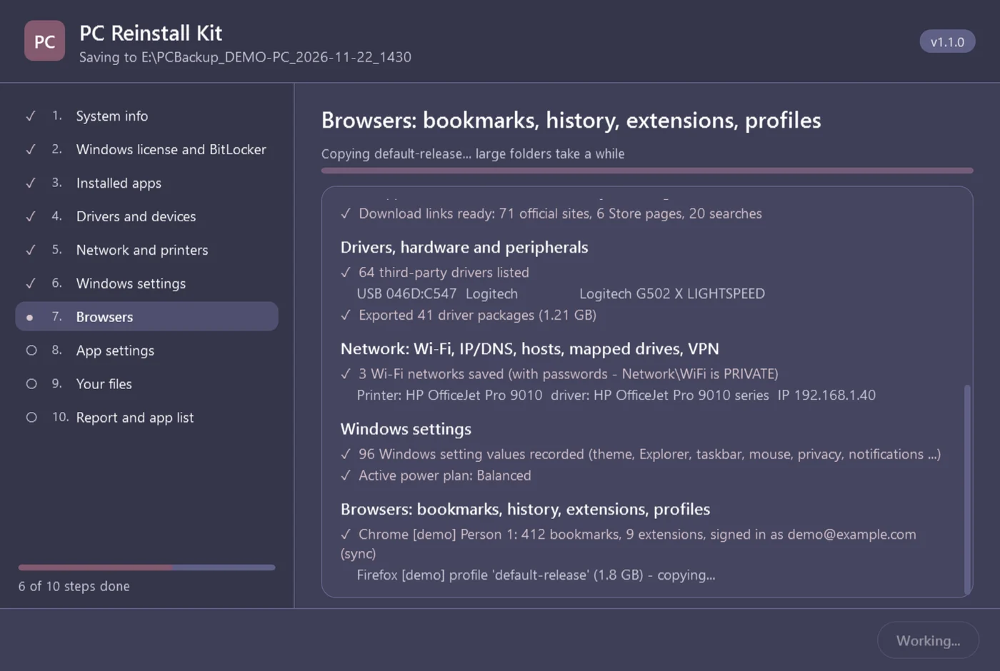
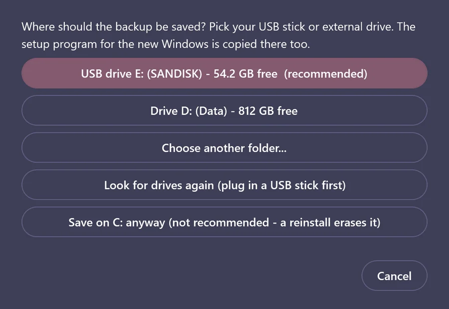
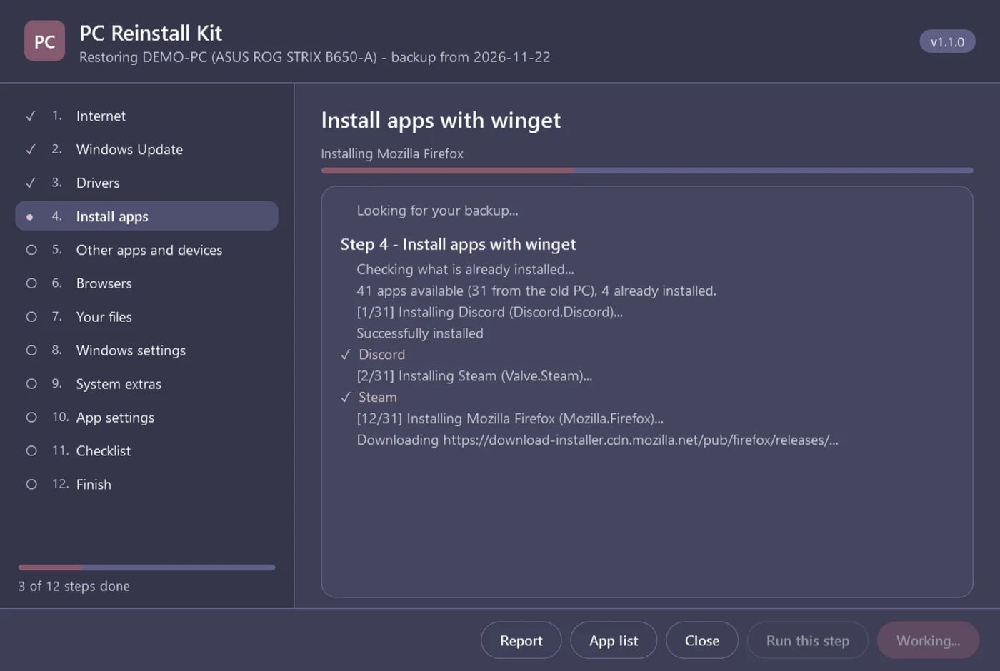
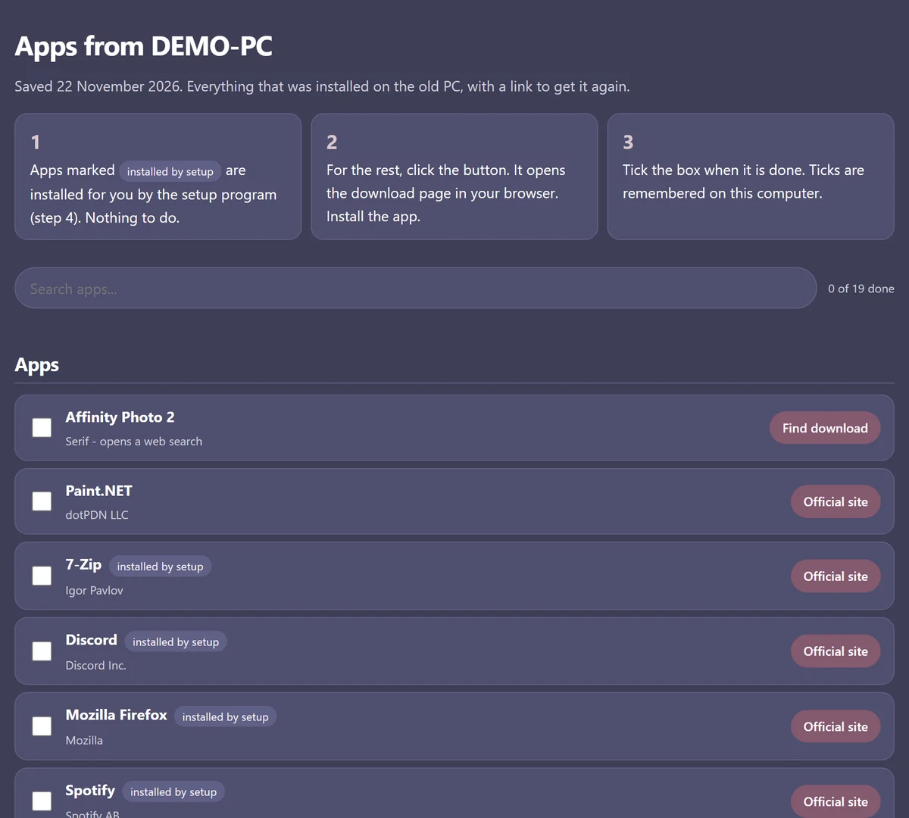
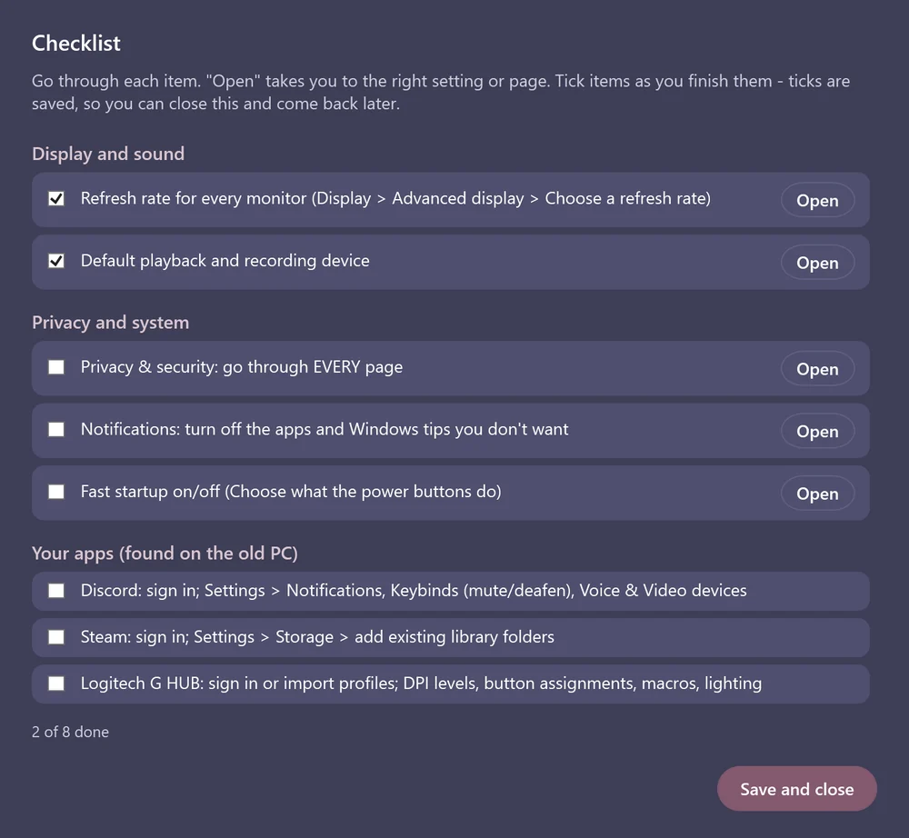

## The "what did you have installed?" problem

Someone I know had a Windows install that was corrupted past the point of fixing, so the answer was the usual one: back everything up, wipe it, reinstall. The wiping part takes twenty minutes. The part that takes all evening is everything after, when you're sitting at a fresh desktop trying to remember which apps you had, which Wi-Fi password the printer room uses, where your bookmarks went, and why your mouse suddenly feels like it's on ice.

I have my own version of this. I keep a scruffy checklist of everything I do on a new PC: chipset and GPU drivers, 7-Zip, my mouse software and DPI settings, about fifteen Firefox extensions, turning off fast startup, turning off OneDrive, fixing the refresh rate that Windows always resets to 60 Hz. It works for me. It does not work for anyone else, because nobody else has my setup.

So I built something generic instead: **PC Reinstall Kit**, two programs on a USB stick.

## Part one: back up the old PC

You run `1-BACKUP-OLD-PC.bat`, click "Start backup", and pick where to save. USB drives are listed first, because a backup saved on the drive you're about to wipe is not a backup.

Then it goes through the PC and writes down everything it can find:

- **Every installed program**, sorted into apps, games, launchers, drivers, and runtimes, with a flag on anything that probably needs a license key or a deactivation first (Adobe, Office, and friends).
- **Drivers**, exported, so the network driver can go back on before the new install has internet.
- **Devices**: which mouse, keyboard, controller, and headset were plugged in, and which software each one needs.
- **Windows settings**: about 90 of them, from dark mode and taskbar layout to mouse speed, Alt+Tab behavior, notifications, and fast startup.
- **Network**: saved Wi-Fi networks with passwords, printers, mapped drives, VPNs.
- **Browsers**: bookmarks, history, and the extension list for Chrome, Edge, Brave, Opera, and Vivaldi, plus full Firefox and Thunderbird profiles.
- **App settings** for the usual suspects: VS Code, SSH keys, Outlook signatures, OBS scenes, Sticky Notes, Minecraft worlds.
- **Your files**, if you want them: Desktop, Documents, Pictures and the rest, already ticked.

When it's done, the USB stick holds the backup, a copy of the whole kit, and a file called `START HERE - after reinstalling Windows.txt`. The idea is that the stick becomes the setup drive. You shouldn't need to remember anything, including this blog post.

## Part two: set up the new PC

After the reinstall, you plug the stick in, double-click `2-SETUP-NEW-PC.bat`, and click "Start setup". It finds the backup by itself and goes through twelve steps: get internet working, Windows Update, drivers, reinstall apps, browsers, files, settings, and a final checklist.

The app step is the one that saves the most time. Anything the backup found that Windows' own package manager knows about gets reinstalled automatically, ticked by default, and you untick whatever you don't want back. For everything else there's an `apps.html` page with a download button per app.

The last step is the part that replaced my scruffy checklist. It's a list of everything Windows can't safely change for you, like privacy settings, notifications, and default apps, each with an "Open" button that drops you on the right settings page. It also adds reminders for apps it found on the old PC, so if you had Discord, it reminds you to redo your keybinds and notification settings.

Every step asks before it changes anything, the highlighted button is always the sensible choice, and you can close it at any point and pick up where you left off, even after a restart.

## The four bugs that nearly ate it

I built this with Claude Code, the same way I've been building everything lately: I decide what it should do, Claude writes the code, and I test it on a real PC and complain. It went from "a script" to "an app with a window" in a day, and the most interesting parts were the bugs, because every one of them was a Windows quirk rather than a logic mistake.

**The backup that backed itself up.** The first person to try it ran the kit from their Downloads folder. The backup was saved next to the kit, also in Downloads. Downloads is one of the folders it copies. So it copied the backup into the backup, then copied that, nesting deeper and deeper until the disk filled up. Every copy now explicitly skips the backup folder, and running from C: now points you at a USB stick instead.

**"It's waiting for Enter after every folder."** It wasn't. The old-style Windows console has a feature where clicking inside the window starts selecting text, and while text is selected, the program just freezes until you press Enter. Copying a big folder is silent, so you click the window to see if it's alive, which freezes it, then you press Enter and it carries on. It looked exactly like the script was asking for something. The kit now turns that off for its own window (and later got a real window anyway).

**The report that never finished.** The backup saves a summary file at the end, and on my PC it just never finished. The culprit turned out to be one tiny piece of it: the custom entries from the Windows hosts file, a small system file that maps website names to addresses. In Windows PowerShell 5.1, every line you read from a file secretly carries extra information about which drive and folder it came from, and the step that saves the summary tried to follow all of that into PowerShell's own internals, which point back at each other forever. Storing the lines as plain text fixed it. Finding it took a background test run and a log line before every section.

**`H` is not a function name.** The report used a tiny helper called `H` to make text safe for a web page. In PowerShell, `h` is already a built-in shortcut for "show my command history", and built-in shortcuts beat functions, so the report was calling the wrong thing entirely. Its cousin: PowerShell variable names ignore upper and lower case, so a loop variable called `$b` was quietly overwriting `$B`, the backup folder path.

None of these show up if you only read the code. They all showed up within minutes of running it on a real machine, which is why I keep doing that.

## Try it

It's free and open source: [github.com/zle3/pc-reinstall-kit](https://github.com/zle3/pc-reinstall-kit). Grab `pc-reinstall-kit.zip` from the latest release, unzip it onto a USB stick, and run the backup on the old PC before you wipe it.

A few honest notes:

- Windows SmartScreen will probably say "Windows protected your PC" the first time, because it's a downloaded script nobody has signed. "More info" and "Run anyway" gets past it.
- Everything stays on your USB stick, and nothing is uploaded anywhere. That also means the stick holds things like your Wi-Fi passwords, so keep it somewhere sensible. The last setup step offers to delete the private bits once everything works.
- Saved passwords in Chrome and Edge can't be copied as files. They're locked to the old Windows install. The backup walks you through exporting them, or you can just turn on browser sync before you wipe.

And if your setup is anything like mine, edit `checklist.txt` before you start. It's yours.
