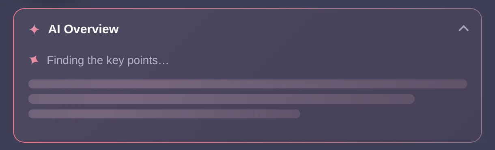
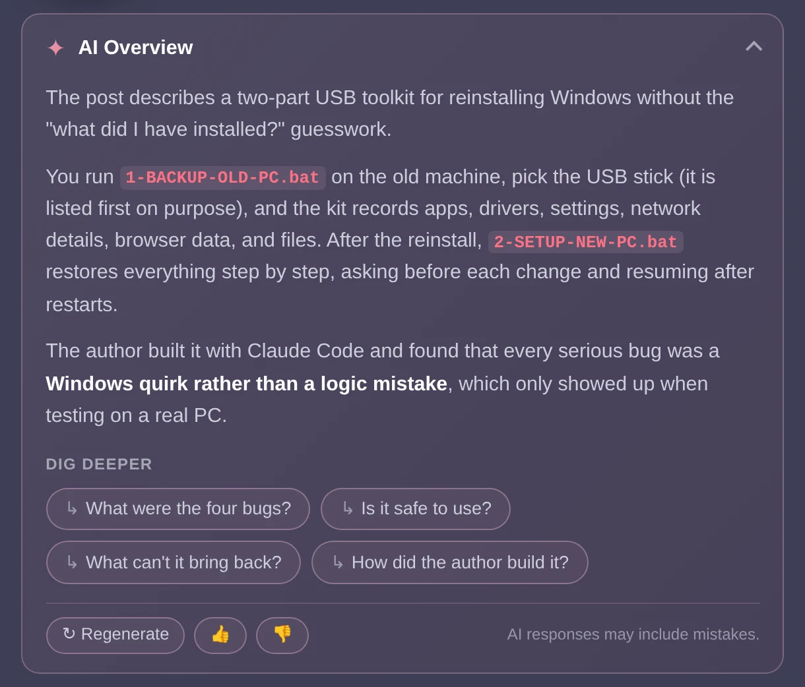
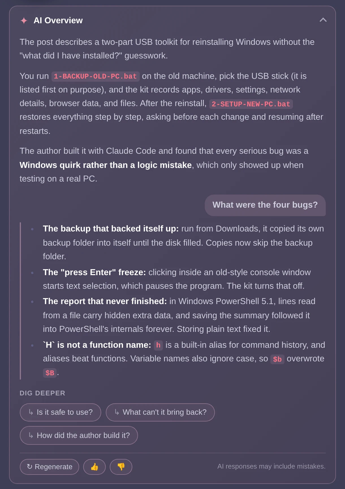

## Everything has a summary button now

Search results have one. Docs sites have one. Half the apps I use have one. At some point it started to feel like a page without an "AI Overview" box at the top was missing something, so I asked Claude Code for one on every blog and portfolio post on this site.

The catch: I'm cheap. I am not spending AI credits so a stranger can get a summary of my blog post about a summary button. So no model call on every click, no API key on a static site, no bill, and nothing about the reader sent anywhere. So the brief was a fake. It should look and feel like a real AI overview, think for a moment, stream the answer in, and offer follow-up questions, but every response is written ahead of time and pulled at random from a list.

You can try it at the top of this post.

## What it does

Click "AI Overview" and it starts thinking. A little sparkle spins, a status line steps through "Reading the post", "Finding the key points", "Checking the details", and "Writing a summary", and some placeholder lines shimmer underneath. That takes somewhere between 1.4 and 2.8 seconds, picked at random each time, because a model that always takes exactly two seconds is a model that isn't thinking.



Then the summary streams in a few words at a time, with a slightly uneven pause between chunks so it reads like tokens arriving instead of a typewriter. Under it, "Dig deeper" offers three or four follow-up questions.



Clicking a follow-up drops it into the thread as your message, it thinks again, and the answer streams in under it. Each question disappears once you've asked it. "Regenerate" picks a different summary. The thumbs up and down buttons say "Thanks for the feedback" and go absolutely nowhere, which, to be fair, is also how it feels to use the real ones.



And yes, it has the little "AI responses may include mistakes" line at the bottom. It felt wrong to leave it off.

## The fake part is the timing

Here's the honest bit: the text isn't fake. Claude wrote every summary and every answer, it just did it once, ahead of time, instead of live on every click. I paid for those credits exactly once, and that's the only time I'm paying for them.

Each post folder now has an `ai-overview.yaml` next to the post, with three summaries and the follow-ups:

```yaml
overviews:
  - |
    First version of the summary...
  - |
    Second version, worded and structured differently...
followups:
  - question: What were the four bugs?
    answers:
      - |
        The answer...
```

There are three summaries per post and they're meant to differ in shape, not just wording: one is a bold lead with bullets, one is a couple of short paragraphs, one starts with "In short:". That way "Regenerate" actually looks like it regenerated something.

To write them for every existing post, Claude split the job across three helper agents, each reading a batch of posts and writing their files. The rules were strict: only facts that appear in that post, no rounding numbers differently, no names, written in the flat third-person voice of a summary ("The post describes...", "The author..."), and no em dashes. For the AI agent platform series that meant no counts or details that aren't in the specific part being summarised, since a lot of that project is still private.

It mostly held. The one that needed fixing was the oldest portfolio entry, which is literally one photo of my server rack from 2024. There isn't much to summarise about a photo, and the first draft filled the gap with a line about it being "a starting point for the homelab work that later posts build on". True, sort of, but the page doesn't say that, so it came out. A summary that adds things is the exact failure people complain about with the real ones.

## Keeping it from rotting

This site gets content from agents working in different projects that don't talk to each other, so anything that depends on "remember to do X" will eventually get forgotten. The content checker now has an `overview` rule: every blog and portfolio post needs an `ai-overview.yaml` with the right shape, short enough follow-up questions, and no dashes. The build also warns about any post without one. It's a minor rule, so a missing overview gets flagged but doesn't block a deploy. The worst case is a post without the button, not a broken site.

The contributor docs got a page on the format and the writing rules, and the new-post checklists got a step for it. This post went through the same checklist, so it has its own overview at the top. It summarises this post, about a fake summary, written by the same AI the summary is pretending to be. I'm choosing not to think about that too hard.
