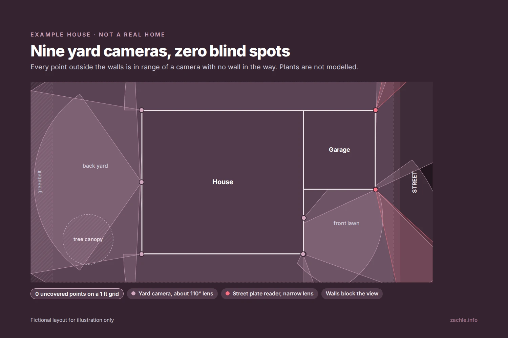

## Why bother?

For years my home network was one big flat subnet. My desktop, my phone, the TV, a couple of game servers that face the internet, both Proxmox hosts, and the web pages that manage the router and switch all sat next to each other. Anything on the network could reach anything else.

That was fine until I started planning two things: UniFi security cameras and a Home Assistant setup full of cheap IoT devices. Cameras and smart plugs are exactly the kind of gear you don't want sharing a network with your server management pages. So before buying anything, I wanted a real plan.

I did the planning with Claude Code, the same way I've been building everything lately: I describe the house and the gear, answer a lot of questions, and push back when something looks wrong. This post covers the first day. Nothing has been cut over yet; this is the design work.

**A note on what's not here:** this post contains no real camera layout and no real floor plan. Publishing where your cameras point (and where they don't) is a gift to anyone who wants to avoid them. The camera section uses a made-up house to show the method instead.

## Where I started

| Role | Gear |
| --- | --- |
| Router / firewall | MikroTik RB5009 (2.5G WAN, 10G SFP+) |
| Switch | Brocade ICX7250-48P (48 PoE+ ports, 8× 10G SFP+) |
| Wi-Fi | 2× Ruckus R710 running Unleashed |
| Server A | Repurposed desktop running Proxmox |
| Server B | Dell R730xd running Proxmox, 12 drives in ZFS |
| DNS | AdGuard Home, one copy per host |
| Rack | 25U sound-damped enclosed cabinet in a living area |
| Internet | 2.5 Gbps fiber, public dynamic IP |

The goals: keep trusted devices away from IoT and guests, get ready for cameras and Home Assistant, put management interfaces out of reach, and give the internet-facing game servers their own zone.

## Scoping: let it ask questions

The first thing I asked for was "ask me as many questions as you need." That turned out to be the most useful instruction of the day. The first round covered the obvious things (firmware versions, the current IP plan, the DHCP pool, ISP details), and also things I wouldn't have thought to write down:

- **How comfortable am I with the RouterOS command line?** (Honest answer: not very, but willing to learn.) That decided how the runbooks are written: copy-paste blocks, one change at a time, with a way back after each step.
- **How much downtime can I take?** One evening. That split the work into a no-downtime staging phase and a single cutover night.
- **Which devices should be able to reach the management network?** My desktop, laptop, and a jump box. Nothing else.
- **What do the servers actually run?** That decided which VMs go where, instead of putting "servers" in one bucket.

It also caught a wrong assumption early. I thought I was behind CGNAT. A quick check showed a public (dynamic) IP, which changes what remote access and port forwarding can look like.

## VLANs and a default-deny firewall

The design ended up as seven VLANs plus a VPN range. Each VLAN is a /24, and the VLAN ID matches the third octet, so `x.x.80.15` is obviously an IoT device. The router is `.1` on every VLAN.

| VLAN | Name | What lives there |
| --- | --- | --- |
| 10 | Servers | Proxmox VMs and containers, DNS |
| 40 | Management | Proxmox hosts, switch, APs, UPS, IPMI |
| 50 | Trusted | PCs, phones, laptops |
| 60 | DMZ | Internet-facing game servers |
| 80 | IoT | Smart plugs, TVs, Home Assistant devices |
| 90 | Cameras | UniFi cameras and the Protect recorder |
| 100 | Guest | Internet only |
| VPN | | WireGuard and Tailscale clients |

Traffic between VLANs is **denied by default**, and each allowed path is written down in a firewall matrix: trusted devices can reach servers, a short list of admin machines can reach management, Home Assistant can reach IoT but IoT can't start connections back, cameras talk only to their recorder and never to the internet, the DMZ can reach the internet and nothing internal. DNS is the one service every VLAN gets, and it points at AdGuard.

Remote access goes through Tailscale. While reviewing the router, I turned off every existing port forward. The game servers will get theirs back once they live in the DMZ.

## First live change, and the first lesson

The only change made on the real network so far was moving the two access points into a small reserved block, so they sit together with room to add more later. I also asked why an AP with a static IP would need a DHCP reservation at all. The answer: the reservation documents the address in one place and stops the router from handing it out to something else.

The first AP dropped off the network after the change and stayed off. Rebooting didn't help. The cause was a mismatched subnet mask and gateway: the AP had a new address and old settings, so it couldn't reach anything outside its own idea of the subnet. Once those matched, both APs came back.

Small mistake, but it set the tone for the cutover runbook: **change one thing, check it, and keep a way back.**

## A floor plan editor with enterprise names

To plan wall jacks, Wi-Fi, and cameras, I needed a floor plan, and I didn't have a good one. So Claude built me a small web editor where I could drag rooms around until they matched reality.

A few choices made it much more useful than a drawing:

- **Enterprise-style names.** Rooms are numbered clockwise from the front door (101, 102...). Corridors are C101 and up, doors are D plus the room plus a letter, windows are W plus the room, jacks are J-room-n, cameras are CAM-xx, and outdoor zones are EXT-xx. Every conversation after that was precise: "move J-104-1 to the north wall" leaves no room for confusion.
- **Locked dimensions.** Anything I actually measured gets locked, so dragging one room can't quietly change a measured wall. Unmeasured rooms stay flexible.
- **Real wall thickness.** Exterior walls are 6 inches and interior walls are 4.5, so the totals add up the way a tape measure does.
- **Layers and filtered views:** floor plan only, network, cameras, Wi-Fi, site, and "confirmed only".

Most of the day's back-and-forth happened here. I'd measure a room, point out a wall that didn't exist ("the living room's east side is open"), or note that the whole plan was too wide, and the plan got rebuilt around the new numbers. The best rule I set: the online listing photos were good for room layout only. The outside of my house, the fixtures, and the floors are different.

## Wall jacks, Wi-Fi, and cable counts

With a plan I trusted, the network layout followed:

- **Ceiling APs** instead of an AP sitting on a shelf inside a metal rack, which is roughly the worst place for one.
- **A wall plate wherever a desk or a screen might go**, even if it's Wi-Fi today. Pulling cable once is much cheaper than pulling it twice.
- **Count every run, then add spares.** Wall jacks, APs, and cameras together came to a little over two dozen runs, which means a second patch panel just for cameras, and roughly 1,350 to 1,650 feet of cable.
- **Route by what's reachable.** My attic gets tight near the edges, so runs are planned through the middle near the hatch, and the open garage ceiling takes the rest. A run through the garage wall gets sealed with fire-rated caulk, because that wall is a fire separation.

The plan also kept what already works. An unmanaged switch that feeds two bedrooms stays where it is, on the trusted VLAN, until those rooms get real drops.

## Camera planning, shown on a made-up house

This is the method, not my house. The example below is a fictional single-story house that faces east onto a street, with the garage on the north-east corner and a backyard on a greenbelt.

**1. Split the outside into zones.** Front lawn, driveway, both side yards, backyard, patio, street. Every zone has to be visible from at least one camera, and the ones that matter (doors, driveway, side gates) from two.

**2. Use real lens specs.** My first pass assumed 120° lenses. Ubiquiti's spec sheets say about 110° for the turrets and bullets I was looking at, and the night-vision range is 30 to 40 m, not "as far as the eye can see." Ten degrees doesn't sound like much, but at the corners of a house it's the difference between covered and not.

**3. Walls block cameras.** The first coverage check only measured distance and angle. Then I asked why a side camera was "covering" a zone on the other side of the house, and the answer was that the checker ignored walls. The fixed version casts a ray from each camera to every 1-foot grid point outside the house. A point counts as covered only if it's within range, inside the lens angle, and not behind a wall. The editor clips each cone the same way, so the picture matches the check.

**4. Mount on corners and look back along the walls.** Side yards are almost impossible to cover from the middle of a side wall. A camera on the front corner looking down the side yard, plus one on the back corner looking the other way, covers it with overlap.

**5. Plants aren't modelled.** A tree canopy or a hedge can hide a whole zone. The grid check is a starting point. The live camera feeds are the real test.

**License plate readers are a different problem.** A plate reader isn't a wide camera with more pixels. It needs a narrow view, the plate within about 12 to 15 m, and the car passing at a shallow angle (under about 25°). Reading cars going both ways on a street takes two of them, one aimed each way, mounted where the street is closest to the house. Anything farther away, like an intersection down the road, is a job for a PTZ camera with real optical zoom, not a plate reader.

## Rack cooling: the mistake that changed the plan

The rack is an enclosed, sound-damped cabinet with a glass front. The only air intake is a set of filtered vents at the bottom, and the back has mounting spots for six 120 mm exhaust fans. I already had a DIY fan controller plan from an earlier session, built around six very fast server fans I owned.

Then the numbers got checked. The old plan assumed half an amp per fan. The datasheet said **2.2 A each, 3.2 A at startup**, so six of them would need about 20 A at 12 V, which no small fan controller on the market can supply. Every controller I looked at after that failed on one detail: one needed a power connector my setup doesn't have, one topped out at 2.5 A, and one didn't ship to the US.

The plan that stuck ("Path B"):

- **6× ARCTIC P12 Max.** High static pressure, which matters because the air has to be pulled through filters and sound baffling. About 0.3 A each, so roughly 2 A for all six.
- **A ready-made ESP32 four-channel PWM controller** with ESPHome firmware and inputs for temperature probes. Two Y-splitters run six fans on four channels.
- **Three temperature probes:** intake (low front), exhaust (top rear), and a hot spot behind the switch. The fan curve follows the difference between exhaust and intake, and goes to 100% if a probe goes missing.
- **The controller mounts outside the cabinet**, because a metal sound-damped box is also very good at blocking Wi-Fi. It joins the IoT network, and Home Assistant picks it up from there.
- **Blanking panels on every empty slot.** With a sealed glass front, any gap lets hot exhaust loop back to the front, and the servers breathe it in again.

## The server rack: current vs proposed

| Slot | Current | Proposed | Why |
| --- | --- | --- | --- |
| Top | 4 unused Raspberry Pis | Brush panel for cables coming down from the attic | Pis go back in the parts bin; new runs need a clean way in |
| U22 | Shelf with the Wi-Fi AP | UniFi Protect recorder | The AP moves to a ceiling, where Wi-Fi actually works |
| U21 to U19 | Router, patch panel, switch | Same, unchanged | Short patch cables, already working |
| U18 | Cable manager | Second patch panel for cameras | Cameras get their own panel and their own VLAN |
| U17 | Empty | Cable manager (moved down) | Sits between both panels and the switch |
| U16 | Empty | Shelf for a PoE++ injector | For a future PTZ camera |
| U15 to U12 | Empty | Blanking panels | Stops hot air looping back to the front |
| U11 to U5 | Both servers | Both servers, unchanged | |
| U2 to U1 | Empty, no UPS | 1500 VA pure sine wave UPS | Heaviest item at the bottom; clean shutdowns |

The theme is simple: **network on top, servers in the middle, power at the bottom, and no open gaps.** The UPS talks to a NUT server on bare metal (not a VM with USB passthrough), so both hosts can shut down in order when the battery runs low.

There's also a bigger question still open. A rack in the living area isn't great for resale, and it adds heat to a room people use. One option is to move the network termination (patch panels, router, and PoE switch) into a hall closet, then run fiber to a small 10G switch in the rack for the servers. The closet would only hold about 100 to 130 W of network gear, the living area gets quieter, and a future buyer sees a normal network closet. It costs a few hundred dollars more and some closet space, so I haven't decided yet.

## The purchasing rule

Every item on the shopping list had to answer one question: **why?** "It might be useful" doesn't count. Gear I already own gets reused first, which is why the unmanaged bedroom switch stays and the old fast fans become spares rather than e-waste. Each line on the list has a part number, a vendor, and a reason.

Two shopping notes for anyone doing the same: UniFi's store adds tariff surcharges at checkout, so the listed price isn't the price you'll pay. And measure your cabinet's depth before buying a rack-mount UPS.

## What's next

- Save config backups from the router, switch, and both hosts before touching anything.
- Write the staging and cutover runbooks from those backups.
- Phase 1: create the VLANs and make the Proxmox bridges VLAN-aware, with no downtime.
- Phase 2: cutover evening (with a keyboard and monitor next to Server A, just in case).
- Then the default-deny firewall, the DMZ, cameras, IoT, and monitoring, in that order.
- Fans and the controller arrive soon, so the cooling build is probably Part 2.
