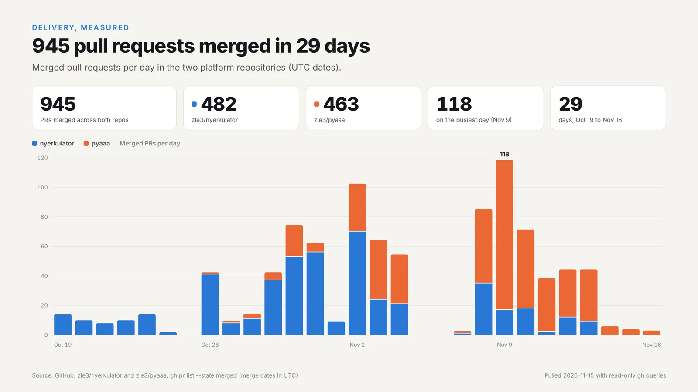
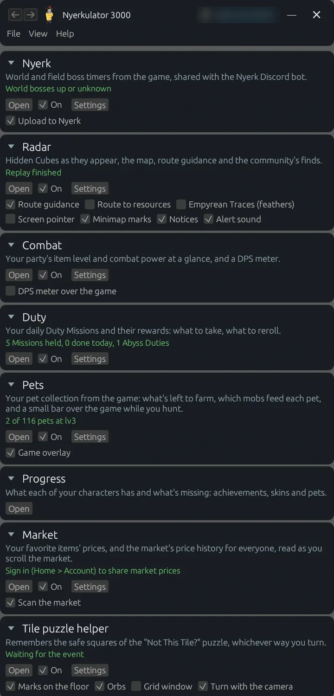
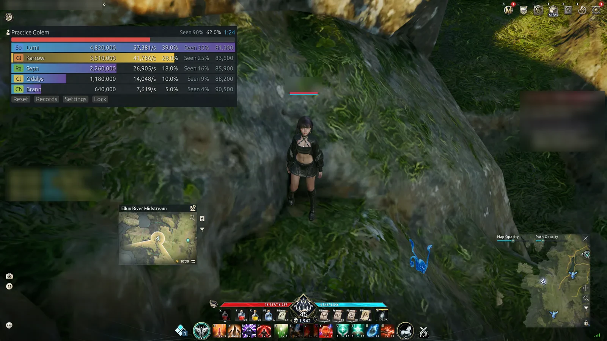
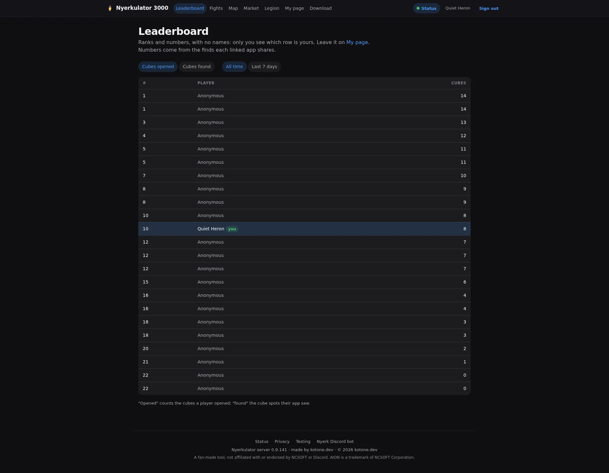
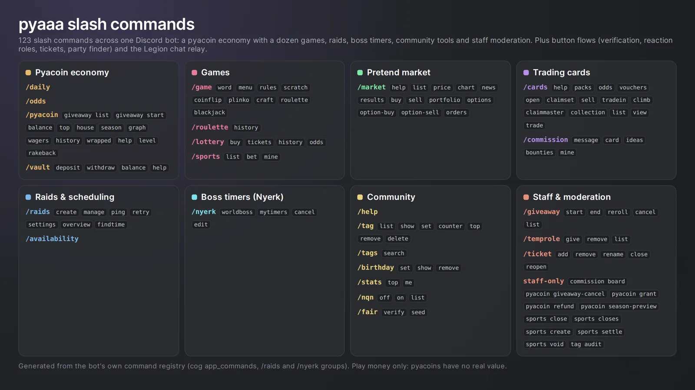

## What this is

A self-hosted platform for an Aion 2 gaming community that I founded and run. It started on October 15th as Cube Radar, a small Windows app that did one thing, and about a month later it's a desktop companion app, a members website and a Discord bot that runs the community server, all on my own homelab hardware.

The twist is how it got built. I didn't hand-write most of the code. A team of **29 specialized Claude Code agents** wrote the code, tests and most of the docs, each working inside rules I wrote: who can merge, who can deploy, what every change has to pass, and what agents can and can't touch on a live host. I set the direction, tested builds, and approved every merge, every deploy and every host change. So this is really an AI operations and systems administration project: change control, access control, backups, release management and security, for a team that can open dozens of pull requests in a day.



The full build log is a series on the blog:

- [Part 1: From Cube Radar to Nyerkulator](/blog/2026/ai-agent-platform-part-1)
- [Part 2: Running 29 AI Agents Like a Dev Team](/blog/2026/ai-agent-platform-part-2)
- [Part 3: Production Access Without a Shell](/blog/2026/ai-agent-platform-part-3)
- [Part 4: Reading a Game Without Touching It](/blog/2026/ai-agent-platform-part-4)
- [Part 5: Fixing Minimap Tracking from User Reports](/blog/2026/ai-agent-platform-part-5)
- [Part 6: Faster Without Changing a Single Output](/blog/2026/ai-agent-platform-part-6)
- [Part 7: A Provably Fair Play-Money Economy](/blog/2026/ai-agent-platform-part-7)

The repos are private and still in active development, so there's no source link this time.

## By the numbers

- **945 merged pull requests in 29 days** across the two main repos (482 app and server, 463 Discord bot), with 118 on the busiest day.
- **29 Claude Code agents**, one per feature plus server, bot, security, deploy and a single merge-queue agent.
- **54 monthly active app installs**, 27 monthly signed-in members and about 18 daily active users at peak, within about a month of launch.
- **4,539 tests** passing in the Discord bot's pre-merge check, with gitleaks finding no leaks across 996 commits.

## What it does

**Nyerkulator 3000, the desktop app** (Rust, egui, a single signed `.exe`). A home page of tools: Radar for Hidden Cubes with a route planner and a 3D arrow drawn over the game, Duty quests, Pets, Market prices, a tile puzzle helper, world boss timers, a DPS meter and a relay that copies the legion's in-game chat to Discord.

It reads the game **passively**. It watches the game's own network traffic through Npcap and reads the screen for things like the minimap and chat. It never touches game memory, never injects anything and never sends anything to the game.

**The website and server** (Rust, axum, SQLite). A members-only site with a personal page for each member, a leaderboard, the legion roster, app sign-in and account linking, admin pages, a usage dashboard and a staff console for approvals. Members show up anonymously by default, so the leaderboard shows ranks and numbers and only you can see which row is yours.

**pyaaa, the Discord bot** (Python, discord.py). It manages the community server itself: roles, verification tiers, channel access and raid signups, plus a play-money coin economy with about a dozen provably fair games, seasons and a simulated stock market. 123 slash commands in 8 categories. Coins have no real value.

**Nyerk**, an older bot for boss timers, a party finder and game news, now folded into pyaaa.

## How it's run

The interesting part isn't any one feature, it's the operating model around the agents:

- **One merger.** A single merge-queue agent is the only thing allowed to merge. It takes PRs one at a time, or in small batches of independent ones, assigns version numbers at merge time, and merges only the exact commit that passed.
- **A full check on every PR.** Every pull request, docs-only ones included, has to pass a full local check (15 to 20 minutes) on its exact final commit before it can merge. Independent review before merge is a written rule.
- **Agents never get a shell on the hosts.** Their SSH key is locked to one root-owned program that answers a fixed list of named questions, with tokens, IPs and IDs masked before anything leaves the host.
- **Host changes need my passkey.** Deploys and host changes are queued through the web server, but each host's root helper checks the request against its own catalog and verifies my WebAuthn passkey itself, so the server in the middle doesn't have to be trusted. Everything goes into a hash-chained audit log.
- **Signed updates.** App releases are signed with an Ed25519 key that never leaves my PC. The app checks the signature, expiry, version, size and hash before installing, and rolls back if the new version doesn't start.

## Infrastructure and security

- **Two Proxmox hosts.** The primary runs everything. The standby is kept about a second behind with Litestream, restore-tested every night, and switched over with a script. In a hard-kill trial under write load, the newest 0.74 seconds of writes were lost, which is the honest cost of async replication.
- **No inbound ports.** Every stack dials out to Cloudflare through its own tunnel, and a WAF rule gates the admin API.
- **Digest-pinned deploys.** Images are built from clean checkouts, pushed to GHCR and deployed by digest, so only the exact image I approved can start. Containers run as non-root on read-only distroless images with all capabilities dropped.
- **Migration with no drama.** Moving the services to a new host took under 75 seconds of downtime per cut, with SHA-256 checks of each database.

## Challenges, briefly

Each one has its own write-up in the series:

- **Minimap tracking from user reports.** Radar once decided the HP bar was a minimap. Switching from a box search to finding the minimap by the icons on its frame took tracking from 64% of frames to 100%, path error from 12 to 13 m down to 1.2 to 1.8 m, and finding the minimap again after a HUD move from almost two minutes to 0.3 seconds. ([Part 5](/blog/2026/ai-agent-platform-part-5))
- **Chat reading 14 times faster, with identical output.** Reading one chat box went from 1,662 ms to 116 ms, with the old and new code agreeing on all 17,782 test images. ([Part 6](/blog/2026/ai-agent-platform-part-6))
- **An app that stays quiet.** UI wake-ups over a 3.5-hour idle session went from 256,162 to 7, and each packet is now decoded once instead of about 9 times, verified identical on 140 of 141 real recordings. ([Part 6](/blog/2026/ai-agent-platform-part-6))
- **Mobs at coordinates that can't exist.** A field read one byte early for flying or turning mobs; after the fix, all 2,137 affected packets line up with their mob. ([Part 4](/blog/2026/ai-agent-platform-part-4))
- **Parallel agents racing to merge.** Fixed with the single merge-queue agent and per-PR changelog fragments. ([Part 2](/blog/2026/ai-agent-platform-part-2))
- **Provably fair games.** Commit-reveal seeds with HMAC-SHA256 results anyone can check with a short script, plus an append-only ledger reconciled every hour. ([Part 7](/blog/2026/ai-agent-platform-part-7))

## Timeline

- **Oct 15:** Cube Radar launches.
- **Oct 15 to 18:** versions 0.3 to 0.7.5 add a route planner, minimap camera reading, the screen arrow, signed updates and a website with Discord sign-in.
- **Oct 18:** M1 splits the code into separate `core`, `radar` and `app` crates with no user-visible change, proven by the same tests, identical screenshots and an identical build.
- **Nyerkulator 1.0.0:** Cube Radar becomes the Radar tool inside one app. Existing users move over through an ordinary signed in-app update, with their old data kept as a backup.
- **Today:** the platform keeps growing, still in active development.

## Tech stack

Rust, egui, axum, SQLite, Litestream, Python, discord.py, Docker, GHCR, Proxmox, Cloudflare Tunnels, Npcap, WebAuthn, Ed25519, Claude Code, GitHub.
